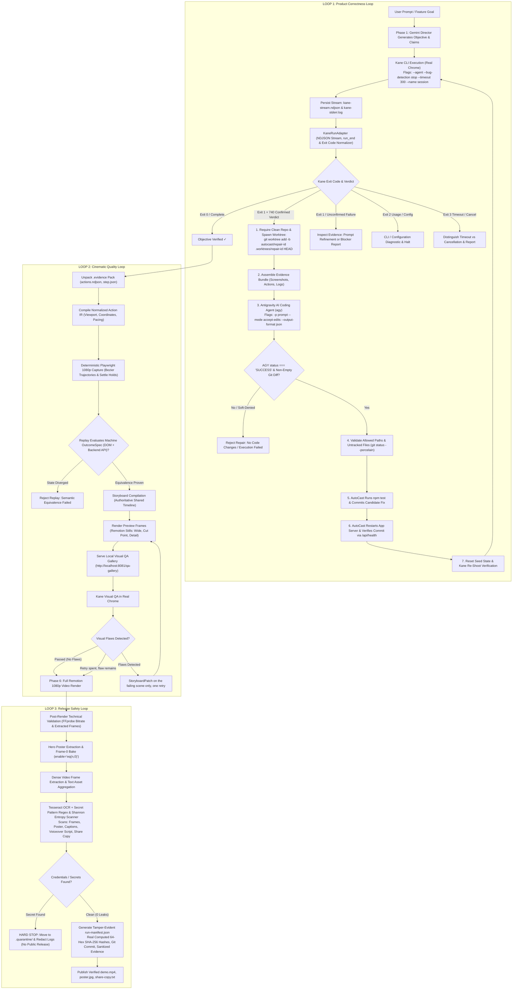
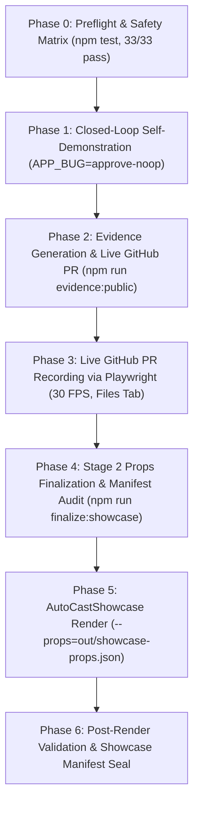

# Autocast AI: Evidence-Driven Closed-Loop Orchestration Engine

> **Tagline:** Demos that can't lie.  
> **Core Architecture:** Three decoupled, evidence-driven orchestration loops proving product correctness, cinematic quality, and release safety.  
> **The Winning Hackathon Story:** A bug is deliberately introduced. Kane CLI catches it (`result_code: 740`). Antigravity AI (`agy`) autonomously repairs the actual application source code in an isolated Git worktree. The candidate repair is committed, the application server restarts on the candidate commit, and Kane re-verifies the fix. Only upon independent state and Kane verification does Autocast render a 1080p demo video accompanied by a tamper-evident provenance manifest.

---

## Architecture Overview: The Three Decoupled Loops

Autocast enforces a strict separation of concerns. **These three loops are non-substitutable:** a visually pristine video does not prove the application works; a working application does not guarantee good video composition; and neither proves the artifact is safe to publish.



---

## 1. Loop 1: Product Correctness Engine

### 1.1 Verified Kane CLI Contract & `KaneRunAdapter`

Kane CLI's `--bug-detection` option defaults to `off`. Without explicitly passing `--bug-detection stop`, Kane will not generate result code `740` with a confirmed product bug verdict.

#### 1. Kane CLI Invocation:
```bash
kane-cli run "$OBJECTIVE" \
  --url "$TARGET_APP_URL" \
  --headless \
  --agent \
  --mode action \
  --bug-detection stop \
  --final-validation on \
  --assertion-failure-mode stop \
  --name "$SESSION_NAME" \
  --timeout 300
```

#### 2. Process Exit Codes & Terminal Event Handling:
The official Kane CLI contract establishes four exit codes:
- **`0`**: Run passed.
- **`1`**: Run failed.
- **`2`**: CLI / configuration / authentication error.
- **`3`**: Cancelled or timed out.

`KaneRunAdapter` consumes stdout line-by-line and persists `kane-stream.ndjson` and `kane-stderr.log` directly in the session directory.

| Process Exit Code | `run_end` Status & Payload | Classification | Engine Action |
|---|---|---|---|
| **`0`** | `status: "passed"` | `PASS` | Advance to Loop 2 (Action IR compilation). |
| **`1`** | `result_code: 740` with `verdict.confirmed === true` | `CONFIRMED_PRODUCT_BUG` | Trigger Antigravity (`agy`) Closed Loop Source Repair (max 2 attempts). |
| **`1`** | `status: "failed"` without confirmed verdict (e.g. checkpoint failed, selector missing) | `UNCONFIRMED_FAILURE` | Inspect evidence pack; do **not** auto-patch application code. If objective was flawed or selector moved, refine with Gemini. |
| **`2`** | No `run_end` (CLI / config / auth refusal) | `CLI_CONFIGURATION_ERROR` | Halt with diagnostic; do not retry. |
| **`3`** | `duration >= timeoutSec` (or timeout reason) | `TIMEOUT` | Report timeout; allow user retry with extended limit. |
| **`3`** | User SIGINT / cancelled event | `CANCELLED` | Graceful abort. |

#### 3. Normalized Internal Schema (`NormalizedKaneResult`):
```typescript
export interface NormalizedKaneResult {
  category: 'pass' | 'confirmed_product_bug' | 'unconfirmed_failure' | 'cli_configuration_error' | 'timeout' | 'cancelled';
  exitCode: number;
  resultCode?: number;
  reasonCode?: string;
  status: 'passed' | 'failed';
  summary: string;
  verdict?: {
    confirmed: boolean;
    family: string;
    category: string;
    severity: string;
    oneLiner: string;
    confidence: number;
  };
  claims: Array<{ id: string; claim: string; passed: boolean }>;
  sessionDir?: string;
  evidencePackPath?: string;
  testUrl?: string;
  creditsConsumed?: number;
  steps: KaneStep[];
  events: any[]; // Full raw NDJSON stream
}
```

---

### 1.2 Antigravity AI Coding Agent Integration (`agy`)

When `CONFIRMED_PRODUCT_BUG` is identified, Autocast invokes the local Antigravity CLI (`/home/home/.local/bin/agy`) under strict process isolation and security controls.

#### Strict Division of Responsibilities (Headless Safe):
In headless mode, Antigravity's `--mode accept-edits` automatically approves workspace file modifications, but commands requiring terminal execution are soft-denied. **AutoCast never asks the agent to run shell commands in headless mode.**

| Task | Handled By | Implementation Details |
|---|---|---|
| Inspect source & locate bug | **Antigravity (`agy`)** | Analyzes code in context of Kane's failure evidence. |
| Modify application source files | **Antigravity (`agy`)** | Patches files in isolated Git worktree under `--mode accept-edits`. |
| Explain modifications | **Antigravity (`agy`)** | Returns structured JSON summary (`status: "SUCCESS"`). |
| Verify modified paths & git diff | **AutoCast Engine** | Validates `git diff --name-only`, `git diff --cached`, and `git status --porcelain=v1 --untracked-files=all`. Rejects symlink escapes and protected file edits (`tests/**`, configs). |
| Run application test suite | **AutoCast Engine** | Executes `npm test` directly in the worktree. |
| Commit candidate fix | **AutoCast Engine** | Commits candidate patch to `autocast/repair-<id>`. |
| Restart application server | **AutoCast Engine** | Spawns new server instance on candidate commit; verifies commit hash in `/api/health`. |
| Reset seed data & trigger Kane | **AutoCast Engine** | Resets test database and invokes Kane re-verification. |

#### Safe Headless Invocation Interface:
```typescript
export interface AgentRepairRequest {
  worktreeDir: string;
  appRelativePath: string; // e.g. "examples/ledgerly"
  objective: string;
  verdict?: { family: string; category: string; oneLiner: string; severity: string };
  failingStep?: string;
  evidence: {
    sessionDir: string;
    evidencePackPath?: string;
    failureScreenshot?: string;
    consoleLogs?: string[];
    networkErrors?: string[];
  };
  constraints: {
    allowedDirectories: string[];
    protectedPaths: string[];
    maxRepairAttempts: number; // max 2
  };
}

export async function invokeAntigravityRepair(request: AgentRepairRequest): Promise<AgentRepairResult> {
  const agyBinary = process.env.AGY_PATH || '/home/home/.local/bin/agy';
  
  // Explicitly resolve appDir inside worktreeDir to avoid ambiguous paths
  const appDir = path.resolve(request.worktreeDir, request.appRelativePath);
  if (!appDir.startsWith(path.resolve(request.worktreeDir))) {
    throw new Error('Security Error: appRelativePath resolves outside worktreeDir');
  }

  // Wrap web-derived text in strict passive data boundaries to prevent prompt injection
  const prompt = `
You are fixing a verified product bug detected by Kane CLI in ${appDir}.

<UNTRUSTED_EVIDENCE_CONTEXT>
Objective: ${request.objective}
Failing Step: ${request.failingStep}
Bug Summary: ${request.verdict?.oneLiner || 'Assertion failed'}
Evidence Log: ${request.evidence.consoleLogs?.join('\n') || 'None'}
Failure Screenshot Reference: ${request.evidence.failureScreenshot || 'None'}
</UNTRUSTED_EVIDENCE_CONTEXT>

TASK:
1. Inspect the source code in ${appDir}.
2. Fix the defect in the application logic so that the user flow succeeds.
3. Do not modify test files, fixtures, or configuration files.
4. Output your analysis and changes in structured format.
`.trim();

  const child = spawn(agyBinary, [
    '-p', prompt,
    '--mode', 'accept-edits',
    '--output-format', 'json',
  ], {
    cwd: request.worktreeDir,
    env: { ...process.env },
  });

  // Enforce 180s timeout, process-group termination (SIGTERM -> SIGKILL),
  // and validate that JSON output contains status === "SUCCESS" (not merely exit 0).
  ...
}
```

---

### 1.3 Application Lifecycle Adapter & 7-Step Verification Lifecycle

To prevent hardcoding Ledgerly-specific endpoints across the engine, Autocast introduces an `AppLifecycleAdapter`:

```typescript
export interface AppLifecycleAdapter {
  name: string;
  appDir: string;
  start: () => Promise<{ pid: number; port: number; commit?: string }>;
  stop: () => Promise<void>;
  healthCheck: (expectedCommit?: string) => Promise<boolean>;
  resetSeedData: () => Promise<void>;
  verifyUnderlyingState: (expected: Record<string, any>) => Promise<boolean>;
}
```

#### The 7-Step Verification Lifecycle:
1. **Clean Worktree Isolation**: Require a clean repository (`git status --porcelain`). Create dedicated repair worktree and branch:  
   `git worktree add -b autocast/repair-<id> .worktrees/repair-<id> HEAD`.
2. **Agent Repair**: `agy` modifies code in the worktree. AutoCast inspects:
   - `git diff --name-only`
   - `git diff --cached --name-only`
   - `git status --porcelain=v1 --untracked-files=all`
   If any untracked file or modified path falls outside `allowedDirectories` or touches protected files, reject patch and discard worktree.
3. **App Regression Test**: Execute `npm test` inside worktree.
4. **Candidate Commit**: Commit candidate fix to `autocast/repair-<id>` branch (`git commit -m "fix(autocast): candidate repair for Kane bug 740"`).
5. **Server Restart & Revision-Aware Healthcheck**:
   - Terminate active server process (`SIGTERM` -> `SIGKILL`).
   - Spawn new server instance from candidate commit.
   - Poll `GET /api/health` until HTTP 200 OK **and** `body.commit === candidateCommitHash` (max 15s).
6. **Kane Re-Verification**: Call `resetSeedData()`, then run Kane CLI against the original objective.
7. **Independent Backend State Verification**: Inspect the backend API / database directly (e.g. `GET /api/invoices/INV-1042` verifies status is `Approved` in memory storage, not just an HTML label). Upon success, merge `autocast/repair-<id>` into `main`.

---

## 2. Loop 2: Cinematic Quality Engine

### 2.1 Two-Stage Replay: Action IR & Machine OutcomeSpec

The archived `.evidence` ZIP contains:
- `tests/<test-id>/logs/0-actions.ndjson`: Atomic user actions with timestamps, selectors, and bounding boxes.
- `tests/<test-id>/steps/<step-id>/step.json`: Element coordinates, action types, and durations.
- `tests/<test-id>/auteur/execution.json`: Execution metadata.

#### Stage A: Ingest Evidence into Normalized Action IR
```typescript
export interface ReplayAction {
  id: string;
  type: 'navigate' | 'click' | 'fill' | 'scroll' | 'hover';
  selector?: string;
  value?: string;
  targetRect?: { x: number; y: number; width: number; height: number };
  viewport: { width: number; height: number; deviceScaleFactor: number };
  waitAfterMs: number;
  sourceStep: number;
}

export interface OutcomeSpec {
  id: string;
  verification:
    | { type: 'dom_text'; selector: string; expected: string }
    | { type: 'visible'; selector: string }
    | { type: 'url'; expected: string }
    | { type: 'api_state'; endpoint: string; jsonPath: string; expected: unknown };
}

export interface ActionIR {
  startUrl: string;
  viewport: { width: number; height: number; deviceScaleFactor: number };
  actions: ReplayAction[];
  outcomeSpecs: OutcomeSpec[];
}
```
*Rule:* Unsupported action types are explicitly rejected rather than silently skipped. Coordinate scaling accounts for original source viewport and live element bounding boxes.

#### Stage B: Cinematic Playwright Capture
- Consumes `ActionIR` at 1920x1080 (30 fps).
- Translates coordinates smoothly using cubic-bezier virtual mouse trajectories (`page.mouse.move(x, y, { steps: 25 })`).
- Enforces natural humanized typing delays and visual settle buffers (800ms to 1500ms).
- **Semantic Equivalence Verification**: Replay independently checks all `OutcomeSpec` items (DOM visibility + backend API state). If state diverges from Kane's verified result, replay is rejected.

---

### 2.2 Authoritative Shared Timeline & Local Visual QA Gallery

#### Shared Timeline Definition
A single timeline definition drives both Remotion rendering and visual QA frame lookups:

```
Storyboard JSON  ───►  Shared Timeline Compiler  ───┬───►  Remotion Sequence Components
                                                    ├───►  AuthoritativeTimeline Lookup
                                                    └───►  Preview-Frame Renderer
```

```typescript
export interface CompiledScene {
  sceneId: string;
  startFrame: number;
  endFrame: number;
  durationFrames: number;
  camera: { zoom: number; panX: number; panY: number };
  targetRect: { x: number; y: number; w: number; h: number };
}

export interface AuthoritativeTimeline {
  fps: number;
  totalDurationFrames: number;
  scenes: CompiledScene[];
}
```

#### Visual QA Gallery & Kane Inspection:
1. **Preview Frame Render**: Remotion `renderStill()` renders targeted preview frames:
   - Settled Wide Shot (Scene 1).
   - Mid-Transition Boundary Cut Point (Scene 1 -> Scene 2 transition).
   - Maximum-Zoom Detail View (Scene 3 / Line Items).
   - Final Outro Frame.
2. **Visual QA Gallery Server**: AutoCast serves a local web gallery on port **8081** (`http://localhost:8081/qa-gallery`, avoiding collision with target app on 8080) displaying:
   - Rendered preview frame images.
   - Scene metadata, camera zoom level, and safe-area margin guides.
   - Checklist for Kane: "Verify no viewport clipping, verify right sidebar text does not collide with frame boundary."
3. **Kane Review in Real Chrome**: Kane navigates to `http://localhost:8081/qa-gallery` in headless Chrome and evaluates visual invariants.
4. **Targeted Storyboard Patch**: If Kane detects a visual flaw, patch the storyboard once, then render either way. A flagged frame never blocks the MP4. The only hard stop for "no video" is Loop 1, when Kane confirms a product bug. Secret detection in Loop 3 still quarantines a render. The product on screen is Ledgerly. Do not point this loop at Autocast, Remotion Studio, or the gallery as the app under test.

   Map the failed frame to `sceneId` through `AuthoritativeTimeline`. Classify Kane's summary before spending another model call:

   - **Cropped or cut off** (`crop`, `cut off`, `outside`, `edge`): pull the target rect inward by 8% of its width and height, clamped to 1920×1080, and step `camera.zoom` down by 0.15, floor 1.2.
   - **Overlap or covered text** (`overlap`, `covered`, `sidebar`): shorten `caption` to its first 8 words. Do not move the sidebar in React.
   - **Cursor off the target** (`cursor`): set `cursor.to` to the center of the target rect.
   - **Anything else:** one Gemini call that must return a `StoryboardPatch` of the allowed fields only. If the call fails or the JSON is not a patch, skip the edit.

   ```typescript
   export interface StoryboardPatch {
     sceneId: string;
     issue: 'clipping' | 'sidebar_overlap' | 'excessive_zoom' | 'cursor' | 'other';
     adjustments: {
       zoom?: number;
       panX?: number;
       panY?: number;
       target?: { x: number; y: number; w: number; h: number };
       cursorTo?: [number, number];
       caption?: string;
     };
     reason: string;
   }
   ```

   Allowed fields, and only on the failing scene: `target`, `camera.zoom`, `cursor.to`, `caption`, plus the pan already stored on the compiled scene. Forbidden: `narration`, `audio`, `segments`, `meta`, and every file under `remotion/`. The components stay generic.

   Write the patch, then lint the storyboard. If lint fails, revert that scene and do not call Kane again. If lint passes, re-render and re-check **only the frames that failed**.

   Cap: the first pass, plus one retry. Then render `out/demo.mp4` whether the second pass passed or not. Record the result on `visual_qa.status` as `passed` or `flagged`, with the patch and the frames that were re-checked. Print which frames passed, which field changed, and that the retry budget is spent.

   Worst case for this loop is the preview set plus one retry of the failed frames only. Do not add frames to buy another look. Do not build a timeline editor, a recut, a music bed, or a free-form editor, and do not re-shoot Ledgerly from this loop.

   To demonstrate it, inject one obvious storyboard fault (zoom past the safe cap, or a caption long enough to collide). In the demo video and the README, say the fault was injected. Do not present it as a bug the pipeline discovered on its own.

---

## 3. Loop 3: Release Safety Engine

### 3.1 Fail-Closed Secret Scanning & Quarantine

1. **Multi-Asset Secret Detection**:
   - Dense video frame sampling (every interaction frame, scene boundaries, transition frames, title/outro, plus 1.0s regular intervals).
   - `poster.jpg`.
   - Voiceover narration script & subtitles.
   - `share-copy.txt`.
2. **Scanning Engine**:
   - Tesseract OCR extracts text from pixel frames.
   - Regex & Shannon entropy detectors scan for API keys (e.g. `sk_live_`, `AIzaSy`), JWTs, Bearer tokens, passwords, and private IP/hostname patterns (with `localhost` / internal dev URLs allowlisted).
   - Redacts any matches in logs (e.g. `sk_live_•••••••`).
3. **Accurate Release Security Claim**:
   - Manifest & reports accurately claim: *"No potential secrets were detected in the scanned frames and accompanying text assets."*
4. **Quarantine & Fail-Closed Gate**:
   - If a secret is detected:
     - Rendered MP4 and poster are moved to `.quarantine/` and purged from `out/`.
     - Releases are blocked: artifacts are **never** copied to `examples/output/`.
     - Pipeline exits non-zero with security violation report.
5. **Verified vs. Unverified Status**:
   - If `--skip-review` or `--no-ocr` is enabled, the outro card and manifest are explicitly marked **`UNVERIFIED DRAFT`**. A verified badge is only stamped when all three loops pass.

---

### 3.2 Tamper-Evident Provenance Manifest (`run-manifest.json`)

Autocast calculates and seals `run-manifest.json` after rendering, computing real 64-character SHA-256 hex digests:

```json
{
  "autocast_version": "0.2.0",
  "generated_at": "2026-11-16T15:30:00Z",
  "status": "verified",
  "application": {
    "url": "http://localhost:8080/?logged_in=true",
    "baseline_commit": "f3d9639",
    "tested_commit": "88670cc",
    "state_verified": true
  },
  "kane_verification": {
    "run_id": "autocast-1794815943640",
    "result_code": 100,
    "credits_consumed": 22.14,
    "claims": [
      { "id": "claim-1", "claim": "Approved seal is visible", "passed": true }
    ]
  },
  "closed_loop_repair": {
    "occurred": true,
    "initial_failure": "result_code: 740 (confirmed_product_bug)",
    "agent": "Antigravity CLI (agy 2.0 accept-edits)",
    "candidate_commit": "88670cc",
    "patch_file": "docs/catches/catch-ledgerly-approval/patch.diff",
    "re_verification_run_id": "autocast-1794815943641"
  },
  "visual_qa": {
    "status": "passed",
    "iterations": 1,
    "sampled_frames": [115, 260, 266]
  },
  "safety_audit": {
    "scanned_frames": 36,
    "text_assets_scanned": ["poster.jpg", "share-copy.txt", "narration.json"],
    "secrets_detected": 0,
    "status": "passed"
  },
  "artifacts": {
    "video_sha256": "4a719c8f2b3e8a1d0e5f6a7b8c9d0e1f2a3b4c5d6e7f8a9b0c1d2e3f4a5b6c7d",
    "poster_sha256": "8f3b2c1e9a4d701a2b3c4d5e6f7a8b9c0d1e2f3a4b5c6d7e8f9a0b1c2d3e4f5a"
  }
}
```

#### Sanitized Public Catch Packs:
Raw `.evidence` packs contain local execution identity and network metadata. Autocast publishes sanitized catch packs to `docs/catches/`:
- `failing-screenshot.png` (anonymized demo data).
- `failing-kane-log.txt` (redacted).
- `patch.diff` (clean code diff).
- `passing-screenshot.png`.
- `passing-kane-log.txt`.

---

## 4. Antigravity Skill & CLI Packaging

### 4.1 Native Antigravity Skill (`.agents/skills/autocast/SKILL.md`)
Placed in `.agents/skills/autocast/SKILL.md`. Antigravity's discovery mechanism automatically registers it as the `/autocast` slash command in the interactive Antigravity CLI and IDE.

### 4.2 Standalone CLI Tool
In `package.json`:
```json
{
  "name": "autocast",
  "version": "0.2.0",
  "bin": {
    "autocast": "./dist/cli.js"
  },
  "scripts": {
    "build": "tsc -p tsconfig.build.json",
    "autocast": "tsx src/cli.ts",
    "test": "vitest run"
  }
}
```
Supports local `npm link` and direct execution via `npx autocast` or `node dist/cli.js`.

---

## 5. Revised Implementation Schedule

```
Mon Nov 16: FOUNDATION (P0)
  [x] Ledgerly SaaS target app built & baseline demo rendered (f3d9639)
  [ ] Implement KaneRunAdapter (--bug-detection stop, NDJSON stream, exit codes 0/1/2/3)
  [ ] Implement the one-retry storyboard edit: patch the failing scene, lint or revert, re-check failed frames once, then render either way
  [ ] Implement fail-closed OCR quarantine & secret redaction
  [ ] Create fixture tests for Kane result classifications

Tue Nov 17: CLOSED LOOP (P1 - The Winning Differentiator)
  [ ] Build src/agent/antigravity.ts wrapper (worktree isolation, --mode accept-edits, --output-format json)
  [ ] Build src/app/lifecycle.ts (Ledgerly restart, healthcheck poll with commit verification, seed reset, DB check)
  [ ] Inject Ledgerly bug (APP_BUG=approve-noop)
  [ ] Execute end-to-end closed loop: Kane 740 catch -> agy patch -> restart -> Kane 100 pass
  [ ] Archive sanitized catch evidence in docs/catches/catch-ledgerly-approval/

Wed Nov 18: CINEMATIC REPLAY & TIMELINE (P2)
  [ ] Implement Evidence Normalizer (extract actions.ndjson / step.json into Action IR)
  [ ] Replay executor with cubic-bezier cursor motion & Machine OutcomeSpec verification
  [ ] Build AuthoritativeTimeline compiler from Remotion composition logic
  [ ] Build local Visual QA Gallery endpoint (port 8081) & targeted StoryboardPatch module
  [ ] Generate tamper-evident run-manifest.json with real SHA-256 hashes

Thu Nov 19: SUBMISSION FREEZE & DEMO (P3)
  [ ] Fresh clone clean checkout verification
  [ ] Validate .agents/skills/autocast/SKILL.md
  [ ] Record 3-5 minute presentation demo video highlighting the closed-loop catch
  [ ] Publish launch posts (2 required channels)
  [ ] Final submission before 11:59 PM IST
```

---

## 6. Verification Test Suite Matrix (19 Automated Tests)

| Test ID | Module | Scenario | Expected Behavior |
|---|---|---|---|
| `TEST-01` | `KaneRunAdapter` | Kane returns exit 1 with `verdict.confirmed === true` (740) | Classified as `CONFIRMED_PRODUCT_BUG`; triggers Loop 1. |
| `TEST-02` | `KaneRunAdapter` | Kane returns exit 1 without confirmed verdict (e.g. checkpoint failure) | Classified as `UNCONFIRMED_FAILURE`; no auto source code patch. |
| `TEST-03` | `KaneRunAdapter` | Kane exits code 2 without `run_end` | Classified as `CLI_CONFIGURATION_ERROR`; halts with diagnostic. |
| `TEST-04` | `KaneRunAdapter` | Kane exits code 3 after duration limit | Classified as `TIMEOUT`. |
| `TEST-05` | `Antigravity` | Agent attempts modifying protected file (`tests/**`) | Path guardrail aborts; worktree is reverted. |
| `TEST-06` | `Antigravity` | Agent returns success but leaves `git diff` empty | Repair rejected; reports no changes made. |
| `TEST-07` | `Antigravity` | Agent modifies source but `npm test` fails | Rejected; server is not restarted; no Kane re-run. |
| `TEST-08` | `Lifecycle` | Server fails `/api/health` 200 OK after restart | Aborts with restart failure report. |
| `TEST-09` | `Replay` | Replay final DOM/API state diverges from `OutcomeSpec` | Replay rejected for semantic non-equivalence. |
| `TEST-10` | `Replay` | Action IR encounters unsupported action type | Replay aborts cleanly rather than silently skipping. |
| `TEST-11` | `Visual QA` | Preview frame fails Kane visual QA, the patch is linted, and the retry still fails | MP4 is still rendered. `visual_qa.status` is `flagged`. A lint failure reverts the scene and skips the second Kane run. |
| `TEST-12` | `Safety OCR` | Injected fake API key (`sk_live_...`) in video frame | Video moved to `.quarantine/`; release halted. |
| `TEST-13` | `Safety OCR` | `--skip-review` flag enabled | Outro card & manifest stamped `UNVERIFIED DRAFT`. |
| `TEST-14` | `End-to-End` | Ledgerly `APP_BUG=approve-noop` injected | Verified catch pack generated, passing re-test, sealed `run-manifest.json`. |
| `TEST-15` | `Antigravity` | Agent creates untracked file outside allowed scope | Rejected by `git status --porcelain` check; worktree discarded. |
| `TEST-16` | `Lifecycle` | Candidate server returns HTTP 200 but serves old commit hash | Healthcheck rejects server; aborts repair cycle. |
| `TEST-17` | `Antigravity` | Kane reports another 740 after AGY repair attempt | Halts after configured limit (max 2 attempts). |
| `TEST-18` | `Safety OCR` | Secret visible for 0.5s in transition frame | Detected by interaction & boundary frame scanner. |
| `TEST-19` | `Manifest` | MP4 bytes modified after manifest generation | SHA-256 verification detects tampering. |
| `TEST-20` | `Safety OCR` | Zero frames extracted or OCR worker fails | Fails closed (`passed: false`, with explicit error). |

---

## 7. Hackathon Self-Demonstration Showcase: 8-Phase Execution Runbook

### Core Principle: "Demos that can't lie"
AutoCast's hackathon presentation is produced entirely from its own execution evidence. No pre-recorded mockups or synthetic hardcoded states are accepted; every card, diff, badge, and PR view is linked to machine artifacts verified by Kane CLI and sealed with SHA-256 manifests.



### Phase 0: Preflight & Environment Audit
- Run preflight auditor: `npm run preflight`.
- Verifies active branch is `main`, git working tree is clean (`git status --porcelain === ''`), and local `main` is synchronized with `origin/main`.
- Verify port ownership: `src/app/lifecycle.ts` checks process cmdline before signaling termination.
- Validate test suite: `npm run typecheck && npm test` (all 41 automated unit tests pass, `TEST-01` through `TEST-28`).
- Ensure bug injection healthcheck readiness: `src/cli.ts` verifies `health.bug === 'approve-noop'` via `/api/health` and restarts application if an unbugged instance is running.

### Phase 1: Produce the Closed-Loop Self-Demonstration
Execute the core AutoCast pipeline with bug injection:
```bash
APP_BUG=approve-noop npm run demo -- \
  "Create a cinematic product demo of the invoice approval workflow in Ledgerly. Show the pending approvals dashboard, open invoice INV-1042, inspect its line items, enter an approval note, approve the invoice, and verify the Approved status and digital approval seal."
```
- **Run Isolation**: Every execution initializes a unique `run_id` and isolates output in `out/runs/<run_id>/`.
- **Kane Run 1**: Fails with `Result: 740 · Confirmed product bug` (`approve-noop`). Genuine defect verdict saved with `run_id` to `out/runs/<run_id>/initial-failure-summary.json`.
- **Antigravity AI**: Clones isolated worktree `.worktrees/repair-*`, enforces read-only `tests/**`, runs worktree regression command `npm test`, applies verified patch to `examples/ledgerly/server/index.js`.
- **Candidate Verification**: Unit regression tests pass; candidate server starts on candidate commit (`9ef4bade88e`).
- **Kane Run 2**: Re-executes full browser journey, certifies `Result: 100 · Passed`.
- **State Check**: Independent backend verification (`/api/invoices/INV-1042`) confirms `status === 'Approved'` (hard-aborts if false).
- **Candidate Lifecycle Handoff**: Merges candidate branch to main, records `integration_commit`, cleanly stops candidate server in worktree, cleans up worktree, restarts application server from merged main checkout, and verifies health.
- **Playwright Capture**: Replays verified workflow in 1080p -> `out/demo.mp4` and copies to `public/source.mp4`.
- **Visual QA & OCR Audit**: Checks rendered frames; generates `out/run-manifest.json` (tracking `baseline_commit`, `tested_commit`, `integration_commit`) and Stage 1 base props `out/showcase-props.base.json`.

### Phase 2: Public Evidence Generation & Live GitHub PR Creation
1. Generate sanitized machine evidence pack from the current run:
   ```bash
   npm run evidence:public
   ```
   *(Fails closed if genuine Kane failure evidence, patch, or state verification is missing or if `run_id` diverges. Runs `npm test 2>&1`, asserts 100% pass, and archives `test-report.txt`. Regenerates `docs/catches/catch-ledgerly-approval/` with `README.md`, `failure-summary.json`, `success-summary.json`, `patch.diff`, `test-report.txt`, and `run-manifest.json`)*
2. Integrate the verified candidate commit into the PR branch:
   ```bash
   git checkout -b fix/ledgerly-approve-noop
   git add docs/catches/catch-ledgerly-approval
   git commit -m "docs: attach Kane 100 verification evidence pack"
   git push -u origin fix/ledgerly-approve-noop
   ```
3. Enforce diff verification before PR creation:
   ```bash
   git diff origin/main...HEAD -- examples/ledgerly/server/index.js
   ```
4. Open real PR with sanitized public evidence attached:
   ```bash
   gh pr create \
     --title "fix(ledgerly): repair invoice approval state mutation bug [Kane 100 Verified]" \
     --body-file docs/catches/catch-ledgerly-approval/README.md \
     --base main \
     --head fix/ledgerly-approve-noop
   ```
5. Capture dynamic `PR_URL` from output (e.g. `https://github.com/nikhil-r0/autocast/pull/42`).

### Phase 3: Live GitHub PR Recording via Playwright
- Supply the live URL to `scripts/record-pr.ts`:
   ```bash
   PR_URL="https://github.com/nikhil-r0/autocast/pull/<PR_ID>" npm run record:pr
   ```
- Headless Chromium loads live GitHub at 1920x1080, enforces discussion header & title validation, verifies Kane assurance content, clicks into the native **Files changed** tab, asserts patch diff contains `examples/ledgerly/server/index.js`, and captures the verified code diff.
- FFmpeg transcodes raw webm to 1080p @ 30 FPS (`r_frame_rate: 30/1`) -> `public/pr-recording.mp4`.
- FFprobe verifies 1920x1080, 30 FPS, duration > 5s.

### Phase 4: Stage 2 Props Finalization & Manifest Gate Audit
1. Finalize Remotion showcase props by binding live GitHub PR metadata:
   ```bash
   PR_URL="https://github.com/nikhil-r0/autocast/pull/<PR_ID>" npm run finalize:showcase
   ```
   *(Requires `out/showcase-props.base.json`, asserts `baseProps.runId === manifest.run_id` and testedCommit match, validates `public/source.mp4` and `public/pr-recording.mp4` exist, computes their SHA-256 hashes, verifies `out/run-manifest.json`, and writes `out/showcase-props.json` with zero fallbacks)*
2. Run the standalone auditor to enforce all mandatory release gates:
   ```bash
   npm run verify:provenance
   ```
   - Gates verified:
     1. `manifest.status === 'verified'`
     2. `application.state_verified === true`
     3. `kane_verification.result_code === 100`
     4. `visual_qa.status === 'passed'`
     5. `security_scan.status === 'clean'`
     6. `video.sha256` and `poster.sha256` exact binary match with rendered artifacts on disk

### Phase 5: Render Final 3:45 Showcase Presentation
Render the Remotion composition dynamically bound to `out/showcase-props.json`:
```bash
npm run render:showcase
```
*(Or with parallel concurrency: `npx remotion render AutoCastShowcase out/autocast-hackathon-showcase.mp4 --props=out/showcase-props.json --concurrency=4`)*

### Phase 6: Post-Render Technical Validation & Showcase Manifest Seal
Audit the rendered 3:45 presentation:
```bash
npm run verify:showcase
```
- Inspects technical properties via FFprobe: 1920x1080, H.264, probed 30 FPS (`r_frame_rate: 30/1`), decodable audio stream present, duration 225s ± 5s (220s - 230s).
- Validates source demo run manifest and PR recording on disk and matches checksums.
- Asserts showcase props `runId` and `testedCommit` match `run-manifest.json`.
- Computes SHA-256 checksum of `out/autocast-hackathon-showcase.mp4`.
- Emits and seals `out/showcase-manifest.json` with provenance links to the live PR URL, run ID, tested commit, and source video checksums (fails closed if any gate fails).
