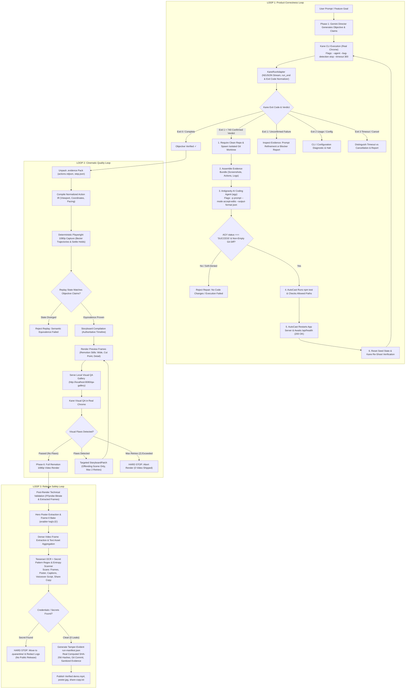

# Autocast AI: Evidence-Driven Closed-Loop Orchestration Engine

> **Tagline:** Demos that can't lie.  
> **Core Architecture:** Three decoupled, evidence-driven orchestration loops proving product correctness, cinematic quality, and release safety.  
> **The Winning Hackathon Story:** A bug is deliberately introduced. Kane CLI catches it (`result_code: 740`). Antigravity AI (`agy`) autonomously repairs the actual application source code in an isolated Git worktree. The application is restarted, health-checked, and re-verified by Kane. Only upon verified pass does Autocast render a 1080p demo video with a tamper-evident provenance manifest.

---

## Architecture Overview: The Three Decoupled Loops

Autocast enforces a strict separation of concerns. **These three loops are non-substitutable:** a visually pristine video does not prove the application works; a working application does not guarantee good video composition; and neither proves the artifact is safe to publish.



---

## 1. Loop 1: Product Correctness Engine

### 1.1 Verified Kane CLI Contract & `KaneRunAdapter`

Kane CLI's `--bug-detection` option defaults to `off`. Without explicitly passing `--bug-detection stop`, Kane will not generate result code `740` with a confirmed product bug verdict.

#### 1. Kane CLI Invocation:
```bash
kane-cli run "$OBJECTIVE" \
  --url "$TARGET_APP_URL" \
  --headless \
  --agent \
  --mode action \
  --bug-detection stop \
  --final-validation on \
  --assertion-failure-mode stop \
  --name "$SESSION_NAME" \
  --timeout 300
```

#### 2. Process Exit Codes & Terminal Event Handling:
The official Kane CLI contract establishes four exit codes:
- **`0`**: Run passed.
- **`1`**: Run failed.
- **`2`**: CLI / configuration / authentication error.
- **`3`**: Cancelled or timed out.

`KaneRunAdapter` processes stdout NDJSON line-by-line, capturing `stream_start`, progress events, `warning`, `error`, and `run_end`. It normalizes them into an unambiguous classification:

| Exit Code | `run_end` Status & Payload | Classification | Engine Action |
|---|---|---|---|
| **`0`** | `status: "passed"` | `PASS` | Advance to Loop 2 (Action IR compilation). |
| **`1`** | `result_code: 740` with `verdict.confirmed === true` | `CONFIRMED_PRODUCT_BUG` | Trigger Antigravity (`agy`) Closed Loop Source Repair. |
| **`1`** | `status: "failed"` without confirmed verdict (e.g. checkpoint failed, selector missing) | `UNCONFIRMED_FAILURE` | Inspect evidence pack; do **not** auto-patch application code. If objective was flawed or selector moved, refine with Gemini. |
| **`2`** | No `run_end` (CLI / config / auth refusal) | `CLI_CONFIGURATION_ERROR` | Halt with diagnostic; do not retry. |
| **`3`** | `duration >= timeoutSec` (or timeout reason) | `TIMEOUT` | Report timeout; allow user retry with extended limit. |
| **`3`** | User SIGINT / cancelled event | `CANCELLED` | Graceful abort. |

#### 3. Normalized Internal Schema (`NormalizedKaneResult`):
```typescript
export interface NormalizedKaneResult {
  category: 'pass' | 'confirmed_product_bug' | 'unconfirmed_failure' | 'cli_configuration_error' | 'timeout' | 'cancelled';
  exitCode: number;
  resultCode?: number;
  reasonCode?: string;
  status: 'passed' | 'failed';
  summary: string;
  verdict?: {
    confirmed: boolean;
    family: string;
    category: string;
    severity: string;
    oneLiner: string;
    confidence: number;
  };
  claims: Array<{ id: string; claim: string; passed: boolean }>;
  sessionDir?: string;
  evidencePackPath?: string;
  testUrl?: string;
  creditsConsumed?: number;
  steps: KaneStep[];
  events: any[]; // Full raw NDJSON stream
}
```

---

### 1.2 Antigravity AI Coding Agent Integration (`agy`)

When `CONFIRMED_PRODUCT_BUG` is identified, Autocast invokes the local Antigravity CLI (`/home/home/.local/bin/agy`) under strict process isolation and security controls.

#### Strict Division of Responsibilities (Headless Safe):
In headless mode, Antigravity's `--mode accept-edits` automatically approves workspace file modifications, but commands requiring terminal execution are soft-denied. **AutoCast never asks the agent to run shell commands in headless mode.**

| Task | Handled By | Implementation Details |
|---|---|---|
| Inspect source & locate bug | **Antigravity (`agy`)** | Analyzes code in context of Kane's failure evidence. |
| Modify application source files | **Antigravity (`agy`)** | Patches files in isolated Git worktree under `--mode accept-edits`. |
| Explain modifications | **Antigravity (`agy`)** | Returns structured JSON summary (`status: "SUCCESS"`). |
| Verify modified paths & git diff | **AutoCast Engine** | Validates `git diff --name-only`; rejects changes to tests or configs. |
| Run application test suite | **AutoCast Engine** | Executes `npm test` directly in the worktree. |
| Restart application server | **AutoCast Engine** | Gracefully terminates old process, spawns new server, polls `/api/health`. |
| Reset seed data & trigger Kane | **AutoCast Engine** | Resets test database and invokes Kane re-verification. |

#### Safe Headless Invocation:
```typescript
export interface AgentRepairRequest {
  worktreeDir: string;
  appDir: string;
  objective: string;
  verdict?: { family: string; category: string; oneLiner: string; severity: string };
  failingStep?: string;
  evidence: {
    sessionDir: string;
    evidencePackPath?: string;
    failureScreenshot?: string;
    consoleLogs?: string[];
    networkErrors?: string[];
  };
  constraints: {
    allowedDirectories: string[];
    protectedPaths: string[];
    maxRepairAttempts: number;
  };
}

export async function invokeAntigravityRepair(request: AgentRepairRequest): Promise<AgentRepairResult> {
  const agyBinary = process.env.AGY_PATH || '/home/home/.local/bin/agy';
  
  // Wrap web-derived text in strict passive data boundaries to prevent prompt injection
  const prompt = `
You are fixing a verified product bug detected by Kane CLI in ${request.appDir}.

<UNTRUSTED_EVIDENCE_CONTEXT>
Objective: ${request.objective}
Failing Step: ${request.failingStep}
Bug Summary: ${request.verdict?.oneLiner || 'Assertion failed'}
Evidence Log: ${request.evidence.consoleLogs?.join('\n') || 'None'}
Failure Screenshot Reference: ${request.evidence.failureScreenshot || 'None'}
</UNTRUSTED_EVIDENCE_CONTEXT>

TASK:
1. Inspect the source code in ${request.appDir}.
2. Fix the defect in the application logic so that the user flow succeeds.
3. Do not modify test files, fixtures, or configuration files.
4. Output your analysis and changes in structured format.
`.trim();

  // Run with --mode accept-edits and --output-format json
  const child = spawn(agyBinary, [
    '-p', prompt,
    '--mode', 'accept-edits',
    '--output-format', 'json',
  ], {
    cwd: request.worktreeDir,
    env: { ...process.env },
  });

  // Enforce 180s timeout, process-group termination (SIGTERM -> SIGKILL),
  // and validate that JSON output contains status === "SUCCESS" (not merely exit 0).
  ...
}
```

---

### 1.3 Application Lifecycle Adapter & Verifiable Patch Integration

To prevent hardcoding Ledgerly-specific endpoints across the engine, Autocast introduces an `AppLifecycleAdapter`:

```typescript
export interface AppLifecycleAdapter {
  name: string;
  appDir: string;
  start: () => Promise<{ pid: number; port: number }>;
  stop: () => Promise<void>;
  healthCheck: () => Promise<boolean>;
  resetSeedData: () => Promise<void>;
  verifyUnderlyingState: (expected: Record<string, any>) => Promise<boolean>;
}
```

#### The 6-Step Verification Lifecycle:
1. **Clean Worktree Isolation**: Require a clean repository (`git status --porcelain`). Create dedicated repair worktree at `git worktree add .worktrees/repair-<id> HEAD`.
2. **Agent Repair**: `agy` modifies code in the worktree. AutoCast inspects `git diff --name-only`: if protected paths (e.g. `tests/**`) were touched, reject patch.
3. **App Regression Test**: Execute `npm test` inside worktree.
4. **Server Restart & Healthcheck**:
   - Terminate active server process (`SIGTERM` -> `SIGKILL`).
   - Spawn new server instance from the repair worktree.
   - Poll `GET /api/health` until HTTP 200 OK (max 15s).
5. **Kane Re-Verification**: Call `POST /api/reset` to restore clean seed state, then run Kane CLI against the original objective.
6. **Independent Backend State Verification**: Inspect the backend API / database directly (e.g. `GET /api/invoices/INV-1042` verifies status is `Approved` in memory storage, not just an HTML label).
7. **Commit & Integrate**: Commit the verified fix to `repair-<id>` branch and merge cleanly into `main`.

---

## 2. Loop 2: Cinematic Quality Engine

### 2.1 Two-Stage Replay: Evidence-Based Action IR & Semantic Equivalence

Kane's actual evidence pack (`.evidence` zip / `session_dir`) contains:
- `logs/<n>-actions.ndjson`: Every atomic user action with timestamps, selectors, and bounding boxes.
- `steps/<step-id>/step.json`: Element coordinates, action types, and durations.
- `events.ndjson`: Real-time streaming events.
- `code-export/` (optional): Generated scripts if supported.

#### Stage A: Ingest Evidence into Normalized Action IR
```typescript
export interface ReplayAction {
  id: string;
  type: 'navigate' | 'click' | 'fill' | 'scroll' | 'hover';
  selector?: string;
  value?: string;
  targetRect?: { x: number; y: number; width: number; height: number };
  viewport: { width: number; height: number; deviceScaleFactor: number };
  waitAfterMs: number;
  sourceStep: number;
}

export interface ActionIR {
  startUrl: string;
  viewport: { width: number; height: number; deviceScaleFactor: number };
  actions: ReplayAction[];
  claims: Array<{ id: string; assertion: string }>;
}
```
*Rule:* Unsupported action types are explicitly rejected rather than silently skipped.

#### Stage B: Cinematic Playwright Capture
- Consumes `ActionIR` at 1920x1080 (30 fps).
- Translates coordinates smoothly using cubic-bezier virtual mouse trajectories (`page.mouse.move(x, y, { steps: 25 })`).
- Enforces natural humanized typing delays and visual settle buffers (800ms to 1500ms).
- **Semantic Equivalence Check**: Following recording, the page's final state is evaluated against the verified claims. If the application state diverges from Kane's verified result, replay is rejected.

---

### 2.2 Authoritative Timeline & Local Visual QA Gallery

#### Authoritative Timeline Compilation
Scene start frames and durations are derived directly from the Remotion composition compiler:

```typescript
export interface CompiledScene {
  sceneId: string;
  startFrame: number;
  endFrame: number;
  durationFrames: number;
  camera: { zoom: number; panX: number; panY: number };
  targetRect: { x: number; y: number; w: number; h: number };
}

export interface AuthoritativeTimeline {
  fps: number;
  totalDurationFrames: number;
  scenes: CompiledScene[];
}
```

#### Visual QA Gallery & Kane Inspection:
1. **Preview Frame Render**: Remotion renders 3 critical preview still frames:
   - Frame A: Settled Wide Shot (Scene 1).
   - Frame B: Mid-Transition Boundary Cut Point (Scene 1 -> Scene 2 transition).
   - Frame C: High-Zoom Detail View (Scene 3 / Line Items).
2. **Visual QA Gallery Server**: AutoCast serves a local web gallery (`http://localhost:8080/qa-gallery` or dedicated port) displaying:
   - Rendered frame images.
   - Scene metadata, camera zoom level, and safe-area margin guides.
   - Interactive checklist for Kane: "Verify no viewport clipping, verify right sidebar text does not collide with frame boundary."
3. **Kane Review in Real Chrome**: Kane navigates to `/qa-gallery` in headless Chrome and evaluates visual invariants.
4. **Targeted Storyboard Patch**: If Kane detects a visual flaw:
   - Frame number is mapped to exact `sceneId` via `AuthoritativeTimeline`.
   - Proposes structured `StoryboardPatch`:
     ```typescript
     export interface StoryboardPatch {
       sceneId: string;
       issue: 'clipping' | 'sidebar_overlap' | 'excessive_zoom';
       adjustments: { zoom?: number; panX?: number; panY?: number; targetW?: number };
       reason: string;
     }
     ```
   - Only the offending scene is modified.
   - Preview frame is re-rendered and re-reviewed by Kane (max 2 iterations).
   - **Hard Stop**: If visual defects persist after 2 iterations, the pipeline halts immediately with exit code 1. Zero video is rendered.

---

## 3. Loop 3: Release Safety Engine

### 3.1 Fail-Closed Secret Scanning & Quarantine

1. **Multi-Asset Secret Detection**:
   - Dense video frame sampling (sampled at 1.5s intervals across all scenes).
   - `poster.jpg`.
   - Voiceover narration script & subtitles.
   - `share-copy.txt`.
2. **Scanning Engine**:
   - Tesseract OCR extracts text from pixel frames.
   - Regex & Shannon entropy detectors scan for API keys (e.g. `sk_live_`, `AIzaSy`), JWTs, Bearer tokens, passwords, and private IP/hostname patterns.
   - Redacts any matches in logs (e.g. `sk_live_•••••••`).
3. **Quarantine & Fail-Closed Gate**:
   - If a secret is detected:
     - Rendered MP4 and poster are moved to `.quarantine/` and purged from `out/`.
     - Releases are blocked: artifacts are **never** copied to `examples/output/`.
     - Pipeline exits non-zero with security violation report.
4. **Verified vs. Unverified Status**:
   - If `--skip-review` or `--no-ocr` is enabled, the outro card and manifest are explicitly marked **`UNVERIFIED DRAFT`**. A verified badge is only stamped when all three loops pass.

---

### 3.2 Tamper-Evident Provenance Manifest (`run-manifest.json`)

Autocast calculates and seals `run-manifest.json` after rendering, computing real SHA-256 hashes:

```json
{
  "autocast_version": "0.2.0",
  "generated_at": "2026-11-16T15:30:00Z",
  "status": "verified",
  "application": {
    "url": "http://localhost:8080/?logged_in=true",
    "tested_commit": "f3d9639",
    "state_verified": true
  },
  "kane_verification": {
    "run_id": "autocast-1794815943640",
    "result_code": 100,
    "credits_consumed": 22.14,
    "claims": [
      { "id": "claim-1", "claim": "Approved seal is visible", "passed": true }
    ]
  },
  "closed_loop_repair": {
    "occurred": true,
    "initial_failure": "result_code: 740 (confirmed_product_bug)",
    "agent": "Antigravity CLI (agy 2.0 accept-edits)",
    "patch_file": "docs/catches/catch-ledgerly-approval/patch.diff",
    "re_verification_run_id": "autocast-1794815943641"
  },
  "visual_qa": {
    "status": "passed",
    "iterations": 1,
    "sampled_frames": [115, 260, 266]
  },
  "safety_audit": {
    "scanned_frames": 24,
    "text_assets_scanned": ["poster.jpg", "share-copy.txt", "narration.json"],
    "secrets_detected": 0,
    "status": "passed"
  },
  "artifacts": {
    "video_sha256": "4a719c8f2b3e8a1d0e5f6...",
    "poster_sha256": "8f3b2c1e9a4d701a2b3..."
  }
}
```

#### Sanitized Public Catch Packs:
Raw `.evidence` packs contain local execution identity and network metadata. Autocast publishes sanitized catch packs to `docs/catches/`:
- `failing-screenshot.png` (anonymized demo data).
- `failing-kane-log.txt` (redacted).
- `patch.diff` (clean code diff).
- `passing-screenshot.png`.
- `passing-kane-log.txt`.

---

## 4. Antigravity Skill & CLI Packaging

### 4.1 Native Antigravity Skill (`.agents/skills/autocast/SKILL.md`)
Placed in `.agents/skills/autocast/SKILL.md`. Antigravity's discovery mechanism automatically registers it as the `/autocast` slash command in the interactive Antigravity CLI and IDE.

### 4.2 Standalone CLI Tool
In `package.json`:
```json
{
  "name": "autocast",
  "version": "0.2.0",
  "bin": {
    "autocast": "./dist/cli.js"
  },
  "scripts": {
    "build": "tsc -p tsconfig.build.json",
    "autocast": "tsx src/cli.ts",
    "test": "vitest run"
  }
}
```
Supports local `npm link` and direct execution via `npx autocast` or `node dist/cli.js`.

---

## 5. Revised Implementation Schedule

```
Mon Nov 16: FOUNDATION (P0)
  [x] Ledgerly SaaS target app built & baseline demo rendered (f3d9639)
  [ ] Implement KaneRunAdapter (--bug-detection stop, NDJSON stream, exit codes 0/1/2/3)
  [ ] Implement strict Loop 3 Visual QA re-review & abort gate (0 MP4 rendered on defect)
  [ ] Implement fail-closed OCR quarantine & secret redaction
  [ ] Create fixture tests for Kane result classifications

Tue Nov 17: CLOSED LOOP (P1 - The Winning Differentiator)
  [ ] Build src/agent/antigravity.ts wrapper (worktree isolation, --mode accept-edits, --output-format json)
  [ ] Build src/app/lifecycle.ts (Ledgerly restart, healthcheck poll, seed reset, DB check)
  [ ] Inject Ledgerly bug (APP_BUG=approve-noop)
  [ ] Execute end-to-end closed loop: Kane 740 catch -> agy patch -> restart -> Kane 100 pass
  [ ] Archive sanitized catch evidence in docs/catches/catch-ledgerly-approval/

Wed Nov 18: CINEMATIC REPLAY & TIMELINE (P2)
  [ ] Implement Evidence Normalizer (extract actions.ndjson / step.json into Action IR)
  [ ] Replay executor with cubic-bezier cursor motion & semantic equivalence verification
  [ ] Build AuthoritativeTimeline compiler from Remotion composition logic
  [ ] Build local Visual QA Gallery endpoint & targeted StoryboardPatch module
  [ ] Generate tamper-evident run-manifest.json with real SHA-256 hashes

Thu Nov 19: SUBMISSION FREEZE & DEMO (P3)
  [ ] Fresh clone clean checkout verification
  [ ] Validate .agents/skills/autocast/SKILL.md
  [ ] Record 3-5 minute presentation demo video highlighting the closed-loop catch
  [ ] Publish launch posts (2 required channels)
  [ ] Final submission before 11:59 PM IST
```

---

## 6. Verification Test Suite Matrix (14 Automated Tests)

| Test ID | Module | Scenario | Expected Behavior |
|---|---|---|---|
| `TEST-01` | `KaneRunAdapter` | Kane returns exit 1 with `verdict.confirmed === true` (740) | Classified as `CONFIRMED_PRODUCT_BUG`; triggers Loop 1. |
| `TEST-02` | `KaneRunAdapter` | Kane returns exit 1 without confirmed verdict (e.g. checkpoint failure) | Classified as `UNCONFIRMED_FAILURE`; no auto source code patch. |
| `TEST-03` | `KaneRunAdapter` | Kane exits code 2 without `run_end` | Classified as `CLI_CONFIGURATION_ERROR`; halts with diagnostic. |
| `TEST-04` | `KaneRunAdapter` | Kane exits code 3 after duration limit | Classified as `TIMEOUT`. |
| `TEST-05` | `Antigravity` | Agent attempts modifying protected file (`tests/**`) | Path guardrail aborts; worktree is reverted. |
| `TEST-06` | `Antigravity` | Agent returns success but leaves `git diff` empty | Repair rejected; reports no changes made. |
| `TEST-07` | `Antigravity` | Agent modifies source but `npm test` fails | Rejected; server is not restarted; no Kane re-run. |
| `TEST-08` | `Lifecycle` | Server fails `/api/health` 200 OK after restart | Aborts with restart failure report. |
| `TEST-09` | `Replay` | Replay final DOM state diverges from Kane `claims` | Replay rejected for semantic non-equivalence. |
| `TEST-10` | `Replay` | Action IR encounters unsupported action type | Replay aborts cleanly rather than silently skipping. |
| `TEST-11` | `Visual QA` | Preview frame fails Kane visual QA twice | Loop 2 aborts pipeline; zero MP4 rendered. |
| `TEST-12` | `Safety OCR` | Injected fake API key (`sk_live_...`) in video frame | Video moved to `.quarantine/`; release halted. |
| `TEST-13` | `Safety OCR` | `--skip-review` flag enabled | Outro card & manifest stamped `UNVERIFIED DRAFT`. |
| `TEST-14` | `End-to-End` | Ledgerly `APP_BUG=approve-noop` injected | Verified catch pack generated, passing re-test, sealed `run-manifest.json`. |
