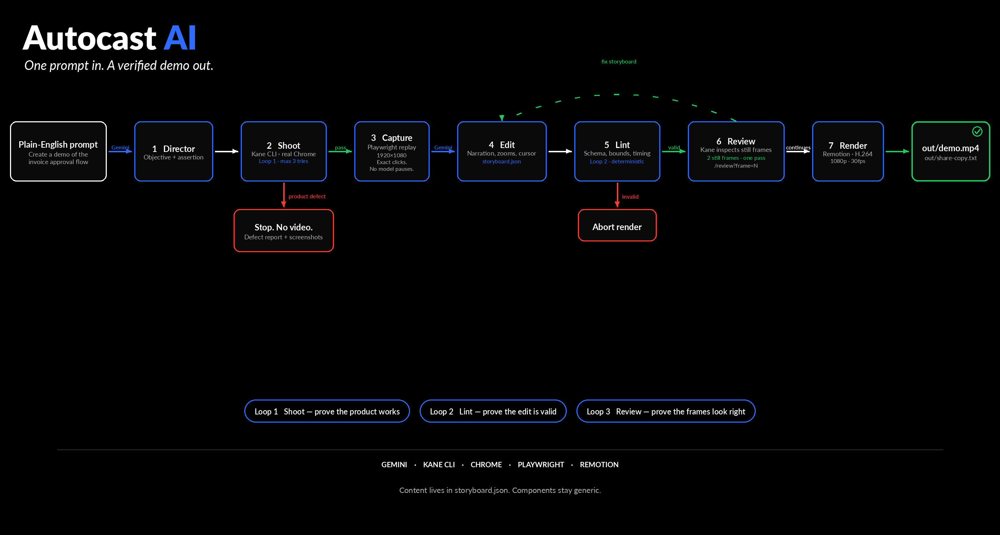

<p align="center">
  
</p>

<h1 align="center">Autocast AI</h1>

<p align="center">
  <strong>The autonomous demo director.</strong><br>
  One plain-English prompt in. A narrated, zoomed, verified product demo out.<br>
  <em>Demos that can't lie.</em>
</p>

Autocast turns a product flow into a finished demo video, and it refuses to ship one that the product cannot actually perform. Kane CLI proves the feature works before a frame is recorded. A second pass proves the edit looks right before the MP4 is written.

No video is rendered when the product fails. No video ships when the edit fails visual review.

## What you get

A single command produces a 1080p, 30fps H.264 demo:

- A real browser walkthrough of the feature, captured at 1920×1080
- Benefit-led narration and scene captions
- Camera zooms, a synthesized cursor, and title and outro cards
- A structured defect report, with screenshots, when the product is broken

A bundled invoice-approval app is included so the pipeline runs without your own product. Point `TARGET_APP_URL` at any web app when you are ready.

## Quick start

**Requirements:** Node.js 18+, Kane CLI signed in (`kane-cli login`), and a Gemini API key if you want generated narration. Without a key, the pipeline falls back to silent captions.

```bash
git clone https://github.com/nikhil-r0/autocast.git
cd autocast
npm install
cp .env.example .env
# Set GEMINI_API_KEY in .env
```

```bash
npm run demo -- "Create a demo of the invoice approval flow"
```

The finished file is `out/demo.mp4`, with a launch blurb beside it at `out/share-copy.txt`. A pre-rendered sample is at `examples/output/sample-demo.mp4`. The matching blurb is `examples/output/share-copy.txt`.

## How a demo is made



A flagged frame does not stop the render. The dashed arrow is the fix: edit `storyboard.json`, then lint again.

| Loop | What it checks | What happens on failure |
| --- | --- | --- |
| Shoot | The live product does what the prompt asked | Render is aborted. A defect report is printed. |
| Lint | The storyboard is valid: schema, zoom bounds, pacing | Render is aborted before Remotion starts. |
| Review | Two still frames stay inside the frame and stay readable | Kane flags the frame. The render still continues. |

Shoot retries are capped at 3. Review checks frames 115 and 260 once. Content lives in `storyboard.json`; the Remotion components stay generic.

## Demos that can't lie

If the approval seal is missing, Autocast does not invent one. Kane catches the failure, the pipeline exits, and nothing is rendered:

```bash
TARGET_APP_URL="http://localhost:8080/?broken=approve" npm run demo
```

Pass `--skip-review` to run shoot, capture, lint, and render without the visual review loop.

## Commands

| Command | Purpose |
| --- | --- |
| `npm run demo -- "<prompt>"` | Full pipeline: verify, capture, edit, review, render |
| `npm run app` | Bundled invoice app on port 8080 |
| `npm run preview` | Remotion Studio |
| `npm run render` | Render the current storyboard to `out/demo.mp4` |
| `npm run lint:storyboard` | Validate `storyboard.json` |
| `npm run typecheck` | TypeScript check |

## Configuration

Copy `.env.example` to `.env`.

| Variable | Role |
| --- | --- |
| `GEMINI_API_KEY` | Objectives, narration, and captions. Optional; silent fallback when unset. |
| `ANTHROPIC_API_KEY` / `OPENAI_API_KEY` | Alternate model providers. |
| `ELEVENLABS_API_KEY` | Optional voiceover. Blank stays silent. |
| `TARGET_APP_URL` | App under test. Defaults to `http://localhost:8080`. |
| `AUTOCAST_CHAOS` | Forces a layout defect so the review loop can be demonstrated. |

## Layout

```
autocast/
├── src/
│   ├── cli.ts                 # Pipeline entry
│   ├── shoot/                 # Objective, Kane run, stop-on-bug
│   ├── capture/replay.ts      # 1080p Playwright replay
│   ├── edit/                  # Narration, storyboard, lint
│   └── review/kaneReview.ts   # Frame-level visual QA
├── remotion/                  # Composition, camera, cursor, cards
├── examples/
│   ├── invoice-app/           # Sample product
│   └── output/                # Sample MP4 and storyboard
├── docs/                      # Cover and design notes
└── storyboard.json            # The edit. Change this, not the components.
```

Further reading: [shoot findings](docs/spike-findings.md) and [the review loop](docs/loop3-review.md).
