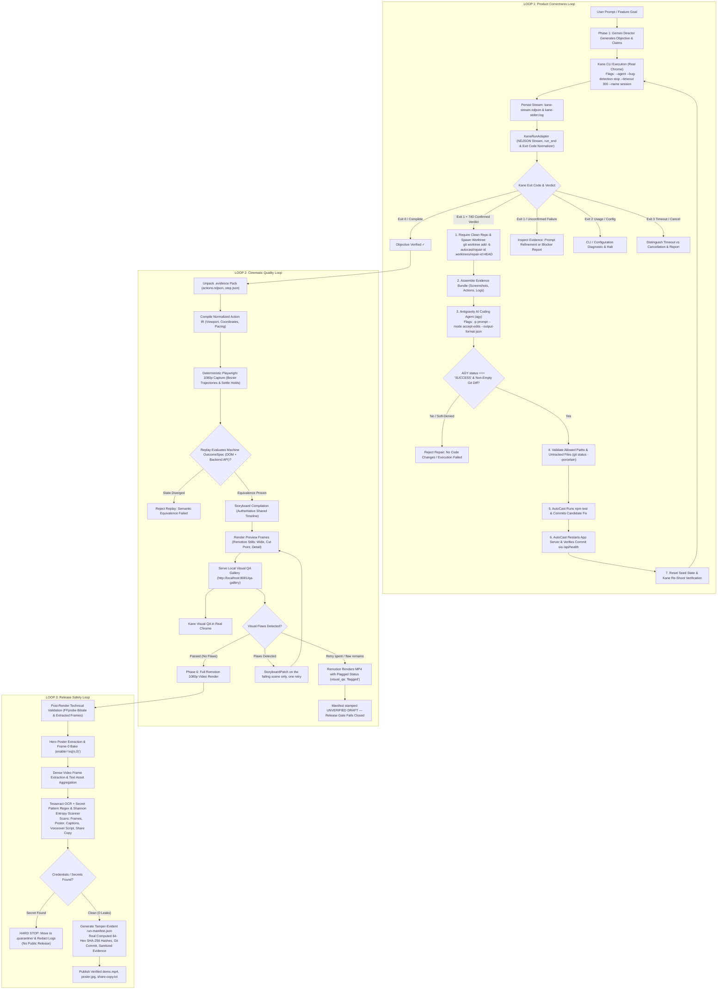
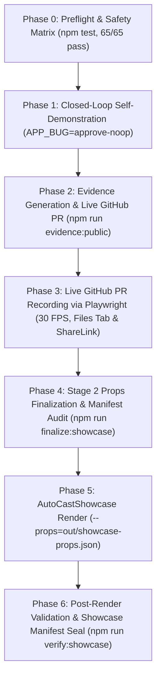

# Autocast AI: Architecture & Verification Specification

> **Tagline:** Demos that can't lie.  
> **Core Architecture:** Three decoupled, evidence-driven orchestration loops proving product correctness, cinematic quality, and release safety.  
> **The Winning Hackathon Story:** A bug is deliberately introduced (`APP_BUG=approve-noop`). Kane CLI catches it (`result_code: 740`). Antigravity AI (`agy`) autonomously repairs the actual application source code in an isolated Git worktree. The candidate repair is committed, the application server restarts on the candidate commit, and Kane re-verifies the fix (`result_code: 100`). Only upon independent state and Kane verification does Autocast render a 1080p demo video accompanied by a tamper-evident SHA-256 provenance manifest.

---

## Architecture Overview: The Three Decoupled Loops

Autocast enforces a strict separation of concerns. **These three loops are non-substitutable:** a visually pristine video does not prove the application works; a working application does not guarantee good video composition; and neither proves the artifact is safe to publish.



---

## 1. Loop 1: Product Correctness Engine

### 1.1 Verified Kane CLI Contract & `KaneRunAdapter`

Kane CLI's `--bug-detection` option defaults to `off`. Without explicitly passing `--bug-detection stop`, Kane will not generate result code `740` with a confirmed product bug verdict.

#### 1. Kane CLI Invocation:
```bash
kane-cli run "$OBJECTIVE" \
  --url "$TARGET_APP_URL" \
  --headless \
  --agent \
  --mode action \
  --bug-detection stop \
  --final-validation on \
  --assertion-failure-mode stop \
  --name "$SESSION_NAME" \
  --timeout 300
```

#### 2. Process Exit Codes & Terminal Event Handling:
The official Kane CLI contract establishes four exit codes:
- **`0`**: Run passed.
- **`1`**: Run failed.
- **`2`**: CLI / configuration / authentication error.
- **`3`**: Cancelled or timed out.

`KaneRunAdapter` consumes stdout line-by-line and persists `kane-stream.ndjson` and `kane-stderr.log` directly in the session directory.

| Process Exit Code | `run_end` Status & Payload | Classification | Engine Action |
|---|---|---|---|
| **`0`** | `status: "passed"` | `PASS` | Advance to Loop 2 (Action IR compilation). |
| **`1`** | `result_code: 740` with `verdict.confirmed === true` | `CONFIRMED_PRODUCT_BUG` | Trigger Antigravity (`agy`) Closed Loop Source Repair (max 2 attempts). |
| **`1`** | `status: "failed"` without confirmed verdict (e.g. checkpoint failed, selector missing) | `UNCONFIRMED_FAILURE` | Inspect evidence pack; do **not** auto-patch application code. If objective was flawed or selector moved, refine with Gemini. |
| **`2`** | No `run_end` (CLI / config / auth refusal) | `CLI_CONFIGURATION_ERROR` | Halt with diagnostic; do not retry. |
| **`3`** | `duration >= timeoutSec` (or timeout reason) | `TIMEOUT` | Report timeout; allow user retry with extended limit. |
| **`3`** | User SIGINT / cancelled event | `CANCELLED` | Graceful abort. |

#### 3. Normalized Internal Schema (`NormalizedKaneResult`):
```typescript
export interface NormalizedKaneResult {
  category: 'pass' | 'confirmed_product_bug' | 'unconfirmed_failure' | 'cli_configuration_error' | 'timeout' | 'cancelled';
  exitCode: number;
  resultCode?: number;
  reasonCode?: string;
  status: 'passed' | 'failed';
  summary: string;
  verdict?: {
    confirmed: boolean;
    family: string;
    category: string;
    severity: string;
    oneLiner: string;
    confidence: number;
  };
  claims: Array<{ id: string; claim: string; passed: boolean }>;
  sessionDir?: string;
  evidencePackPath?: string;
  testUrl?: string;
  shareUrl?: string; // Live hosted Test Manager execution link
  creditsConsumed?: number;
  steps: KaneStep[];
  events: any[]; // Full raw NDJSON stream
}
```

---

### 1.2 Antigravity AI Coding Agent Integration (`agy`)

When `CONFIRMED_PRODUCT_BUG` is identified, Autocast invokes the local Antigravity CLI under strict process isolation and security controls. The CLI binary path is resolved via `process.env.AGY_PATH` (defaulting to `agy` found in system `PATH`).

#### Strict Division of Responsibilities (Headless Safe):
In headless mode, Antigravity's `--mode accept-edits` automatically approves workspace file modifications, but commands requiring terminal execution are soft-denied. **AutoCast never asks the agent to run shell commands in headless mode.**

| Task | Handled By | Implementation Details |
|---|---|---|
| Inspect source & locate bug | **Antigravity (`agy`)** | Analyzes code in context of Kane's failure evidence. |
| Modify application source files | **Antigravity (`agy`)** | Patches files in isolated Git worktree under `--mode accept-edits`. |
| Explain modifications | **Antigravity (`agy`)** | Returns structured JSON summary (`status: "SUCCESS"`). |
| Verify modified paths & git diff | **AutoCast Engine** | Validates `git diff --name-only`, `git diff --cached`, and `git status --porcelain=v1 --untracked-files=all`. Rejects symlink escapes and protected file edits (`tests/**`, configs). |
| Run application test suite | **AutoCast Engine** | Executes `npm test` directly in the worktree. |
| Commit candidate fix | **AutoCast Engine** | Commits candidate patch to `autocast/repair-<id>`. |
| Restart application server | **AutoCast Engine** | Spawns new server instance on candidate commit; verifies commit hash in `/api/health`. |
| Reset seed data & trigger Kane | **AutoCast Engine** | Resets test database and invokes Kane re-verification. |

#### Safe Headless Invocation Interface:
```typescript
export interface AgentRepairRequest {
  worktreeDir: string;
  appRelativePath: string; // e.g. "examples/ledgerly"
  objective: string;
  verdict?: { family: string; category: string; oneLiner: string; severity: string };
  failingStep?: string;
  evidence: {
    sessionDir: string;
    evidencePackPath?: string;
    failureScreenshot?: string;
    consoleLogs?: string[];
    networkErrors?: string[];
  };
  constraints: {
    allowedDirectories: string[];
    protectedPaths: string[];
    maxRepairAttempts: number; // max 2
  };
}

export async function invokeAntigravityRepair(request: AgentRepairRequest): Promise<AgentRepairResult> {
  const agyBinary = process.env.AGY_PATH || 'agy';
  
  // Explicitly resolve appDir inside worktreeDir to avoid ambiguous paths
  const appDir = path.resolve(request.worktreeDir, request.appRelativePath);
  if (!appDir.startsWith(path.resolve(request.worktreeDir))) {
    throw new Error('Security Error: appRelativePath resolves outside worktreeDir');
  }

  // Wrap web-derived text in strict passive data boundaries to prevent prompt injection
  const prompt = `
You are fixing a verified product bug detected by Kane CLI in ${appDir}.

<UNTRUSTED_EVIDENCE_CONTEXT>
Objective: ${request.objective}
Failing Step: ${request.failingStep}
Bug Summary: ${request.verdict?.oneLiner || 'Assertion failed'}
Evidence Log: ${request.evidence.consoleLogs?.join('\n') || 'None'}
Failure Screenshot Reference: ${request.evidence.failureScreenshot || 'None'}
</UNTRUSTED_EVIDENCE_CONTEXT>

TASK:
1. Inspect the source code in ${appDir}.
2. Fix the defect in the application logic so that the user flow succeeds.
3. Do not modify test files, fixtures, or configuration files.
4. Output your analysis and changes in structured format.
`.trim();

  const child = spawn(agyBinary, [
    '-p', prompt,
    '--mode', 'accept-edits',
    '--output-format', 'json',
  ], {
    cwd: request.worktreeDir,
    env: { ...process.env },
  });
  // Enforces 180s timeout, process-group termination, and validates status === "SUCCESS"
}
```

---

### 1.3 Application Lifecycle Adapter & 7-Step Verification Lifecycle

To prevent hardcoding Ledgerly-specific endpoints across the engine, Autocast introduces an `AppLifecycleAdapter`:

```typescript
export interface AppLifecycleAdapter {
  name: string;
  appDir: string;
  start: () => Promise<{ pid: number; port: number; commit?: string }>;
  stop: () => Promise<void>;
  healthCheck: (expectedCommit?: string) => Promise<boolean>;
  resetSeedData: () => Promise<void>;
  verifyUnderlyingState: (expected: Record<string, any>) => Promise<boolean>;
}
```

#### The 7-Step Verification Lifecycle:
1. **Clean Worktree Isolation**: Require a clean repository (`git status --porcelain`). Create dedicated repair worktree and branch:  
   `git worktree add -b autocast/repair-<id> .worktrees/repair-<id> HEAD`.
2. **Agent Repair**: `agy` modifies code in the worktree. AutoCast inspects:
   - `git diff --name-only`
   - `git diff --cached --name-only`
   - `git status --porcelain=v1 --untracked-files=all`
   If any untracked file or modified path falls outside `allowedDirectories` or touches protected files, reject patch and discard worktree.
3. **App Regression Test**: Execute `npm test` inside worktree.
4. **Candidate Commit**: Commit candidate fix to `autocast/repair-<id>` branch (`git commit -m "fix(autocast): candidate repair for Kane bug 740"`).
5. **Server Restart & Revision-Aware Healthcheck**:
   - Terminate active server process (`SIGTERM` -> `SIGKILL`).
   - Spawn new server instance from candidate commit.
   - Poll `GET /api/health` until HTTP 200 OK **and** `body.commit === candidateCommitHash` (max 15s).
6. **Kane Re-Verification**: Call `resetSeedData()`, then run Kane CLI against the original objective.
7. **Independent Backend State Verification**: Inspect the backend API / database directly (e.g. `GET /api/invoices/INV-1042` verifies status is `Approved` in memory storage, not just an HTML label). Upon success, merge `autocast/repair-<id>` into `main`.

---

## 2. Loop 2: Cinematic Quality Engine

### 2.1 Two-Stage Replay: Action IR & Machine OutcomeSpec

The archived `.evidence` ZIP contains:
- `tests/<test-id>/logs/0-actions.ndjson`: Atomic user actions with timestamps, selectors, and bounding boxes.
- `tests/<test-id>/steps/<step-id>/step.json`: Element coordinates, action types, and durations.
- `tests/<test-id>/auteur/execution.json`: Execution metadata.

#### Stage A: Ingest Evidence into Normalized Action IR
```typescript
export interface ReplayAction {
  id: string;
  type: 'navigate' | 'click' | 'fill' | 'scroll' | 'hover';
  selector?: string;
  value?: string;
  targetRect?: { x: number; y: number; width: number; height: number };
  viewport: { width: number; height: number; deviceScaleFactor: number };
  waitAfterMs: number;
  sourceStep: number;
}

export interface OutcomeSpec {
  id: string;
  verification:
    | { type: 'dom_text'; selector: string; expected: string }
    | { type: 'visible'; selector: string }
    | { type: 'url'; expected: string }
    | { type: 'api_state'; endpoint: string; jsonPath: string; expected: unknown };
}

export interface ActionIR {
  startUrl: string;
  viewport: { width: number; height: number; deviceScaleFactor: number };
  actions: ReplayAction[];
  outcomeSpecs: OutcomeSpec[];
}
```
*Rule:* Unsupported action types are explicitly rejected rather than silently skipped. Coordinate scaling accounts for original source viewport and live element bounding boxes.

#### Stage B: Cinematic Playwright Capture
- Consumes `ActionIR` at 1920x1080 (30 fps).
- Translates coordinates smoothly using cubic-bezier virtual mouse trajectories (`page.mouse.move(x, y, { steps: 25 })`).
- Enforces natural humanized typing delays and visual settle buffers (800ms to 1500ms).
- **Semantic Equivalence Verification**: Replay independently checks all `OutcomeSpec` items (DOM visibility + backend API state). If state diverges from Kane's verified result, replay is rejected.

---

### 2.2 Authoritative Shared Timeline & Local Visual QA Gallery

#### Shared Timeline Definition
A single timeline definition drives both Remotion rendering and visual QA frame lookups:

```
Storyboard JSON  ───►  Shared Timeline Compiler  ───┬───►  Remotion Sequence Components
                                                    ├───►  AuthoritativeTimeline Lookup
                                                    └───►  Preview-Frame Renderer
```

```typescript
export interface CompiledScene {
  sceneId: string;
  startFrame: number;
  endFrame: number;
  durationFrames: number;
  camera: { zoom: number; panX: number; panY: number };
  targetRect: { x: number; y: number; w: number; h: number };
}

export interface AuthoritativeTimeline {
  fps: number;
  totalDurationFrames: number;
  scenes: CompiledScene[];
}
```

#### Visual QA Gallery & Kane Inspection:
1. **Preview Frame Render**: Remotion `renderStill()` renders targeted preview frames:
   - Settled Wide Shot (Scene 1).
   - Mid-Transition Boundary Cut Point (Scene 1 -> Scene 2 transition).
   - Maximum-Zoom Detail View (Scene 3 / Line Items).
   - Final Outro Frame.
2. **Visual QA Gallery Server**: AutoCast serves a local web gallery on port **8081** (`http://localhost:8081/qa-gallery`, avoiding collision with target app on 8080) displaying:
   - Rendered preview frame images.
   - Scene metadata, camera zoom level, and safe-area margin guides.
   - Checklist for Kane: "Verify no viewport clipping, verify right sidebar text does not collide with frame boundary."
3. **Kane Review in Real Chrome**: Kane navigates to `http://localhost:8081/qa-gallery` in headless Chrome and evaluates visual invariants.
4. **Targeted Storyboard Patch & Reconciled Release Behavior**:
   - If Kane detects a visual flaw, AutoCast classifies the flaw and applies a targeted `StoryboardPatch` on the failing scene only (e.g. shrinking the target rect by 8%, clamping zoom floor to 1.2, or shortening captions).
   - The patched storyboard is linted. If lint fails, changes are reverted.
   - **Reconciled Visual QA Release Gate:** If visual flaws persist after 1 patch retry, Remotion still renders an MP4 so developers can visually inspect and debug the defect. However, the manifest records `visual_qa.status = 'flagged'` and stamps the artifact `unverified_draft`. The release gate fails closed: **no video is stamped `status: 'verified'` or shipped to production when visual QA fails.**

```typescript
export interface StoryboardPatch {
  sceneId: string;
  issue: 'clipping' | 'sidebar_overlap' | 'excessive_zoom' | 'cursor' | 'other';
  adjustments: {
    zoom?: number;
    panX?: number;
    panY?: number;
    target?: { x: number; y: number; w: number; h: number };
    cursorTo?: [number, number];
    caption?: string;
  };
  reason: string;
}
```

---

## 3. Loop 3: Release Safety Engine

### 3.1 Fail-Closed Secret Scanning & Quarantine

1. **Multi-Asset Secret Detection**:
   - Dense video frame sampling (every interaction frame, scene boundaries, transition frames, title/outro, plus 1.0s regular intervals).
   - `poster.jpg`.
   - Voiceover narration script & subtitles.
   - `share-copy.txt`.
2. **Scanning Engine**:
   - Tesseract OCR extracts text from pixel frames.
   - Regex & Shannon entropy detectors scan for API keys (e.g. `sk_live_`, `AIzaSy`), JWTs, Bearer tokens, passwords, and private IP/hostname patterns (with `localhost` / internal dev URLs allowlisted).
   - Redacts any matches in logs (e.g. `sk_live_•••••••`).
3. **Accurate Release Security Claim**:
   - Manifest & reports claim: *"No potential secrets were detected in the scanned frames and accompanying text assets."*
4. **Quarantine & Fail-Closed Gate**:
   - If a secret is detected:
     - Rendered MP4 and poster are moved to `.quarantine/` and purged from `out/`.
     - Releases are blocked: artifacts are **never** copied to `examples/output/`.
     - Pipeline exits non-zero with security violation report.
5. **Verified vs. Unverified Status**:
   - If `--skip-review` or `--no-ocr` is enabled, the outro card and manifest are explicitly marked **`UNVERIFIED DRAFT`**. A verified badge is only stamped when all three loops pass.

---

### 3.2 Tamper-Evident Provenance Manifest (`run-manifest.json`)

Autocast calculates and seals `run-manifest.json` after rendering, computing real 64-character SHA-256 hex digests:

```json
{
  "autocast_version": "0.2.0",
  "run_id": "autocast-1794815943640",
  "generated_at": "2026-11-18T21:54:00Z",
  "status": "verified",
  "application": {
    "url": "http://localhost:8080/?logged_in=true",
    "baseline_commit": "f3d9639",
    "tested_commit": "adc6a772bfbedc1c0b6a37a1efa836a21c86a7ff",
    "integration_commit": "adc6a772bfbedc1c0b6a37a1efa836a21c86a7ff",
    "state_verified": true
  },
  "kane_verification": {
    "run_id": "autocast-1794815943640",
    "result_code": 100,
    "credits_consumed": 22.14,
    "share_url": "https://test-manager.lambdatest.com/projects/01M7G731FR81J5BGBWP3Y53FHF/test-cases/01M7QC3EMRSVJKXF11RPKAZRVG/dashboard/share/US_LEHGINX5N6K8F08SZWYR5A5CNWSKGJSE4G6G4TU5OWLL2SV3WWU6PZD17ZUJLE30?type=summary&agentView=true&fqdn=summary-page",
    "claims": [
      { "id": "claim-1", "claim": "Approved seal is visible", "passed": true }
    ]
  },
  "closed_loop_repair": {
    "occurred": true,
    "initial_failure": "result_code: 740 (confirmed_product_bug)",
    "initial_share_url": "https://test-manager.lambdatest.com/projects/01M7G731FR81J5BGBWP3Y53FHF/test-cases/01M7QBRZR4FRVMB943TNRAG5PV/dashboard/share/US_DI4N4K9JKH8XJIJV21PI9C1O8S14VK91Q077F66Q6H6O7CBY8G3Q2Z1GZ0IR6PFJ?type=summary&agentView=true&fqdn=summary-page",
    "agent": "Antigravity CLI (agy 2.0 accept-edits)",
    "candidate_commit": "adc6a772bfbedc1c0b6a37a1efa836a21c86a7ff",
    "patch_file": "docs/catches/catch-ledgerly-approval/patch.diff",
    "re_verification_run_id": "autocast-1794815943641"
  },
  "visual_qa": {
    "status": "passed",
    "iterations": 1,
    "sampled_frames": [115, 260, 266]
  },
  "security_scan": {
    "scanned_frames": 36,
    "text_assets_scanned": ["poster.jpg", "share-copy.txt", "narration.json"],
    "secrets_detected": 0,
    "status": "clean"
  },
  "artifacts": {
    "video_sha256": "92d8b6de822825b8a552055694b154312b9ee37368fe42c68e539b6687726f99",
    "poster_sha256": "ce6efd5a00c84b384e52923d8c993d9d3c7c348b0a7cbb604b42153db5a2725f"
  }
}
```

#### Sanitized Public Catch Packs:
Raw `.evidence` packs contain local execution identity and network metadata. Autocast publishes sanitized catch packs to `docs/catches/catch-ledgerly-approval/`:
- `README.md`: Evidence walk summarizing the catch.
- `failure-summary.json`: Kane 740 defect verdict.
- `failing-screenshot.jpg`: Actual browser state at failure.
- `patch.diff`: The exact patch generated by Antigravity AI.
- `success-summary.json`: Kane 100 verification verdict.
- `passing-screenshot.jpg`: Browser state proving approval seal is present.
- `test-report.txt`: Automated regression test run proof.
- `run-manifest.json`: Tamper-evident SHA-256 seal.

---

## 4. Antigravity Skill & CLI Packaging

### 4.1 Native Antigravity Skill (`.agents/skills/autocast/SKILL.md`)
Placed in `.agents/skills/autocast/SKILL.md`. Antigravity's discovery mechanism automatically registers it as the `/autocast` slash command in the interactive Antigravity CLI and IDE.

### 4.2 Standalone CLI Tool
In `package.json`:
```json
{
  "name": "autocast",
  "version": "0.2.0",
  "bin": {
    "autocast": "./dist/cli.js"
  },
  "scripts": {
    "build": "tsc -p tsconfig.build.json",
    "autocast": "tsx src/cli.ts",
    "test": "node --import tsx --test 'tests/**/*.test.ts'"
  }
}
```
Supports local `npm link` and direct execution via `npx autocast` or `npm run demo`.

---

## 5. Shipped Implementation Milestones

All core architecture phases are complete, tested, and verified:

| Phase | Milestone | Shipped Artifacts & Evidence | Status |
|---|---|---|---|
| **Phase 0** | **Foundation & Preflight Architecture** | `scripts/preflight.ts`, branch/clean-tree gates, TypeScript build | **Shipped & Verified** |
| **Phase 1** | **Closed-Loop Antigravity Repair** | `src/agent/antigravity.ts`, worktree isolation, `/api/health` revision check, `APP_BUG=approve-noop` catch | **Shipped & Verified** |
| **Phase 2** | **Action IR Replay & Visual QA Gallery** | `src/capture/replay.ts`, cubic-bezier curves, `OutcomeSpec`, Visual QA gallery on port 8081 | **Shipped & Verified** |
| **Phase 3** | **Pixel Safety OCR & Tamper-Evident Provenance** | Tesseract OCR pixel scanner, Shannon entropy filter, `.quarantine/`, `out/run-manifest.json` (64-char SHA-256) | **Shipped & Verified** |
| **Phase 4** | **3:45 Hackathon Showcase Presentation & Live PR Integration** | `remotion/Showcase.tsx`, `scripts/record-pr.ts`, hosted Kane ShareLinks in PR #2, `out/showcase-manifest.json` | **Shipped & Verified** |

---

## 6. Verification Test Suite Matrix (65 Automated Tests)

The test suite consists of **65 unit and integration tests** (42 core/demo tests plus 23 Oracle Mode & manifest tests across `tests/oracle-*.test.ts` and `tests/manifest.test.ts`) executing via Node's native test runner (`node scripts/run-tests.mjs`). All 65 tests pass with 100% pass rate.

| Test ID | Module | Scenario | Expected Behavior | Status |
|---|---|---|---|---|
| `TEST-01` | `KaneRunAdapter` | Kane returns exit 1 with `verdict.confirmed === true` (740) | Classified as `CONFIRMED_PRODUCT_BUG`; triggers Loop 1. | **Pass** |
| `TEST-02` | `KaneRunAdapter` | Kane returns exit 1 without confirmed verdict | Classified as `UNCONFIRMED_FAILURE`; no auto source code patch. | **Pass** |
| `TEST-03` | `KaneRunAdapter` | Kane exits code 2 without `run_end` | Classified as `CLI_CONFIGURATION_ERROR`; halts with diagnostic. | **Pass** |
| `TEST-04` | `KaneRunAdapter` | Kane exits code 3 after duration limit | Classified as `TIMEOUT`. | **Pass** |
| `TEST-05` | `Antigravity` | Agent attempts modifying protected file (`tests/**`) | Path guardrail aborts; worktree is reverted. | **Pass** |
| `TEST-06` | `Antigravity` | Agent returns success but leaves `git diff` empty | Repair rejected; reports no changes made. | **Pass** |
| `TEST-07` | `Antigravity` | Agent modifies source but `npm test` fails | Rejected; server is not restarted; no Kane re-run. | **Pass** |
| `TEST-08` | `Lifecycle` | Server fails `/api/health` 200 OK after restart | Aborts with restart failure report. | **Pass** |
| `TEST-08b`| `Lifecycle` | Server connection refused (offline server) | Healthcheck returns false cleanly. | **Pass** |
| `TEST-09` | `Replay` | Replay final DOM/API state diverges from `OutcomeSpec` | Replay rejected for semantic non-equivalence. | **Pass** |
| `TEST-10` | `Replay` | Action IR encounters unsupported action type | Replay aborts cleanly rather than silently skipping. | **Pass** |
| `TEST-11` | `Visual QA` | Preview frame fails visual QA, patch is linted, retry fails | MP4 still rendered for audit; `visual_qa.status` is flagged; release gate fails closed. | **Pass** |
| `TEST-12` | `Safety OCR` | Injected fake API key (`sk_live_...`) in video frame | Video moved to `.quarantine/`; release halted. | **Pass** |
| `TEST-13` | `Safety OCR` | `--skip-review` flag enabled | Outro card & manifest stamped `UNVERIFIED DRAFT`. | **Pass** |
| `TEST-14` | `End-to-End` | Ledgerly `APP_BUG=approve-noop` injected | Verified catch pack generated, passing re-test, sealed `run-manifest.json`. | **Pass** |
| `TEST-15` | `Antigravity` | Agent creates untracked file outside allowed scope | Rejected by `git status --porcelain` check; worktree discarded. | **Pass** |
| `TEST-16` | `Lifecycle` | Candidate server returns HTTP 200 but serves old commit hash | Healthcheck rejects server; aborts repair cycle. | **Pass** |
| `TEST-17` | `Antigravity` | Kane reports another 740 after AGY repair attempt | Halts after configured limit (max 2 attempts). | **Pass** |
| `TEST-18` | `Safety OCR` | Secret visible in transition frame text / payload | Detected across all rule patterns. | **Pass** |
| `TEST-19` | `Manifest` | MP4 bytes modified after manifest generation | SHA-256 verification detects tampering. | **Pass** |
| `TEST-20` | `Safety OCR` | Zero frames extracted or OCR worker fails | Fails closed (`passed: false`, with explicit error). | **Pass** |
| `TEST-21` | `Manifest` | Manifest missing required verification fields or artifacts | Fails closed with schema validation error. | **Pass** |
| `TEST-22` | `Lifecycle` | Candidate server running while worktree cleanup begins | Server stopped before worktree removed. | **Pass** |
| `TEST-23` | `Manifest` | Previous run has stale 740 evidence | Evidence generator rejects mismatched `RUN_ID`. | **Pass** |
| `TEST-24` | `Showcase` | `showcase-props.json` has `verified: false` | Showcase verifier rejects presentation render. | **Pass** |
| `TEST-25` | `Showcase` | Source or PR video changes after finalization | Hash mismatch rejected by showcase verifier. | **Pass** |
| `TEST-26` | `Showcase` | PR has the wrong head branch | PR validation aborts cleanly. | **Pass** |
| `TEST-27` | `Showcase` | Showcase finalizer / verifier detects `run_id` mismatch | Aborts with provenance mismatch error. | **Pass** |
| `TEST-28` | `Preflight` | Dirty working tree, wrong branch, or unsynced remote | Preflight audit halts pipeline. | **Pass** |
| `TEST-29` | `Manifest` | Manifest preserves and verifies Kane hosted ShareLinks | Verifies ShareLink presence and accessibility. | **Pass** |
| Unit (12) | Various | Action IR parsing, OutcomeSpec satisfaction, gallery HTTP, zoom floor, caption shortening, cursor centering, lint revert, pattern matching | All 12 unit specifications pass. | **Pass** |
| Oracle (23) | `tests/oracle-*.test.ts`, `manifest.test.ts` | Canonical JSON & `spec_sha256`, strict 40-char commit SHA, Ed25519 signing/tampering, single-write signing, `verifyOracleManifest` split gates, `hold` verdicts (`kane_failed`, `commit_mismatch`, `state_mismatch`, `spec_mismatch`), URL allowlist, `publishVerdict`, `reverify:oracle --reshoot` | All 23 Oracle & manifest tests pass. | **Pass** |

---

## 7. Hackathon Self-Demonstration Showcase: 8-Phase Execution Runbook

### Core Principle: "Demos that can't lie"
AutoCast's hackathon presentation is produced entirely from its own execution evidence. Every card, diff, badge, and PR view is linked to machine artifacts verified by Kane CLI and sealed with SHA-256 manifests.

### The Two Video Artifacts
To avoid confusion, AutoCast distinguishes between two distinct video deliverables:
1. **Product Demo Video (`out/demo.mp4` / ~2:59):** The pure, standalone cinematic walkthrough of the verified Ledgerly invoice approval flow, complete with zoom easing, caption pacing, and the Verified End Card.
2. **Hackathon Showcase Presentation (`out/autocast-hackathon-showcase.mp4` / 3:45 · 225.0s @ 30 FPS):** The comprehensive competition presentation that walks through the full three-loop story: initial Kane 740 failure, Antigravity AI repair, Kane 100 re-verification, animated architecture flowchart, the 2:59 product demo, and a live GitHub PR #2 walkthrough inspecting the diff and clicking the hosted Kane ShareLink.



### Phase 0: Preflight & Environment Audit
- Run preflight auditor: `npm run preflight`.
- Verifies active branch is `main`, git working tree is clean (`git status --porcelain === ''`), and local `main` is synchronized with `origin/main`.
- Validate test suite: `npm run typecheck && npm test` (all 65 automated unit tests pass).
- Ensure bug injection healthcheck readiness: `src/cli.ts` verifies `health.bug === 'approve-noop'` via `/api/health`.

### Phase 1: Produce the Closed-Loop Self-Demonstration
Execute the core AutoCast pipeline with bug injection:
```bash
APP_BUG=approve-noop npm run demo -- \
  "Create a cinematic product demo of the invoice approval workflow in Ledgerly. Show the pending approvals dashboard, open invoice INV-1042, inspect its line items, enter an approval note, approve the invoice, and verify the Approved status and digital approval seal."
```
- **Run Isolation**: Every execution initializes a unique `run_id` and isolates output in `out/runs/<run_id>/`.
- **Kane Run 1**: Fails with `Result: 740 · Confirmed product bug` (`approve-noop`). Genuine defect verdict saved with `run_id` to `out/runs/<run_id>/initial-failure-summary.json`.
- **Antigravity AI**: Clones isolated worktree `.worktrees/repair-*`, enforces read-only `tests/**`, runs worktree regression command `npm test`, applies verified patch to `examples/ledgerly/server/index.js`.
- **Candidate Verification**: Unit regression tests pass; candidate server starts on candidate commit (`adc6a772`).
- **Kane Run 2**: Re-executes full browser journey, certifies `Result: 100 · Passed`.
- **State Check**: Independent backend verification (`/api/invoices/INV-1042`) confirms `status === 'Approved'`.
- **Playwright Capture**: Replays verified workflow in 1080p -> `out/demo.mp4` and copies to `public/source.mp4`.
- **Visual QA & OCR Audit**: Checks rendered frames; generates `out/run-manifest.json` and base props `out/showcase-props.base.json`.

### Phase 2: Public Evidence Generation & Live GitHub PR Creation
1. Generate sanitized machine evidence pack from the current run:
   ```bash
   npm run evidence:public
   ```
   *(Regenerates `docs/catches/catch-ledgerly-approval/` with `README.md`, `failure-summary.json`, `success-summary.json`, `patch.diff`, `test-report.txt`, and `run-manifest.json`)*
2. Integrate the verified candidate commit into the PR branch and open the pull request:
   ```bash
   gh pr create \
     --title "fix(ledgerly): repair invoice approval state mutation bug [Kane 100 Verified]" \
     --body-file docs/catches/catch-ledgerly-approval/README.md \
     --base main \
     --head fix/ledgerly-approve-noop
   ```
   Live submission PR: [`https://github.com/nikhil-r0/autocast/pull/2`](https://github.com/nikhil-r0/autocast/pull/2).

### Phase 3: Live GitHub PR Recording via Playwright
- Record the live pull request using Playwright:
   ```bash
   PR_URL="https://github.com/nikhil-r0/autocast/pull/2" npm run record:pr
   ```
- Headless Chromium loads live GitHub at 1920x1080, verifies Kane assurance content, clicks the hosted Kane ShareLink to navigate to LambdaTest Test Manager, returns to GitHub PR, clicks the **Files changed** tab, and captures the code diff.
- Transcoded to 1080p @ 30 FPS -> `public/pr-recording.mp4`.

### Phase 4: Stage 2 Props Finalization & Manifest Gate Audit
1. Finalize Remotion showcase props by binding live GitHub PR metadata:
   ```bash
   PR_URL="https://github.com/nikhil-r0/autocast/pull/2" npm run finalize:showcase
   ```
2. Run standalone auditor to enforce all 6 mandatory release gates:
   ```bash
   npm run verify:provenance
   ```
   - Release Gate 1: `manifest.status === 'verified'`
   - Release Gate 2: `application.state_verified === true`
   - Release Gate 3: `kane_verification.result_code === 100`
   - Release Gate 4: `visual_qa.status === 'passed'`
   - Release Gate 5: `security_scan.status === 'clean'`
   - Release Gate 6: SHA-256 binary match for video and poster on disk

### Phase 5: Render Final 3:45 Showcase Presentation
Render the Remotion composition dynamically bound to `out/showcase-props.json`:
```bash
npm run render:showcase
```

### Phase 6: Post-Render Technical Validation & Showcase Manifest Seal
Audit the rendered 3:45 presentation:
```bash
npm run verify:showcase
```
- Inspects technical properties via FFprobe: 1920x1080, H.264, probed 30 FPS (`r_frame_rate: 30/1`), stereo AAC, duration 225.0s (within 220s–230s).
- Validates source demo run manifest and PR recording on disk and matches checksums.
- Emits and seals `out/showcase-manifest.json` with provenance links.

---

## 8. Oracle Mode (Payment Acceptance Architecture)

In **Oracle Mode** (`autocast --oracle <spec.json>` or `autocast oracle <spec.json>`), Autocast acts as a deterministic acceptance oracle rather than a repair/demo pipeline:

- **Input:** A frozen, strictly validated [`AcceptanceSpec`](../src/oracle/spec.ts) (`version: 1`) hashed into `spec_sha256` via canonical JSON. `generateKaneObjective` is bypassed completely and `spec.objective` is passed verbatim.
- **Pinned Environment:** `runOraclePreflight` checks clean git state without enforcing branch `main`; `validateOracleTargetUrl` restricts targets to the runner-started origin unless `ORACLE_ALLOWED_HOSTS` allows external hosts; `preparePinnedAppCheckout` isolates `target.expected_commit`; `resetSeedData(seed_id)` resets seed data; and `/api/health` confirms `tested_commit === expected_commit` (else seals `hold` with `commit_mismatch`).
- **Fail-Closed Execution:** Kane runs once (`--bug-detection stop`). Any failure (`740` or unconfirmed failure) seals a signed `hold` manifest (`kane_failed`, exit `1`); timeout/cancel seals `timeout` (exit `3`). Antigravity repair (`agy`) and repair worktrees are disabled (`closed_loop_repair.occurred: false`).
- **Backend Truth & Split Gates:** After Kane `100`, `verifyUnderlyingState` evaluates every `api_state` entry in `outcome_specs` (`state_mismatch` seals `hold`). `verifyOracleManifest` (`npm run verify:oracle`) enforces the 8 payment gates—including Ed25519 signature verification against `ORACLE_TRUSTED_KEYS`—without requiring `visual_qa`, `security_scan`, or `artifacts.video`. See [ORACLE.md](./ORACLE.md) for full details.
