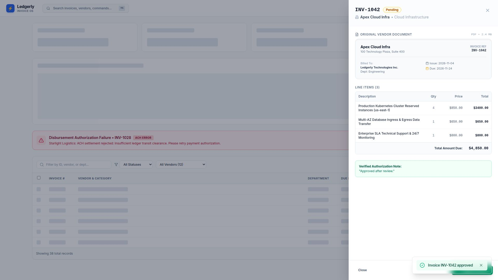
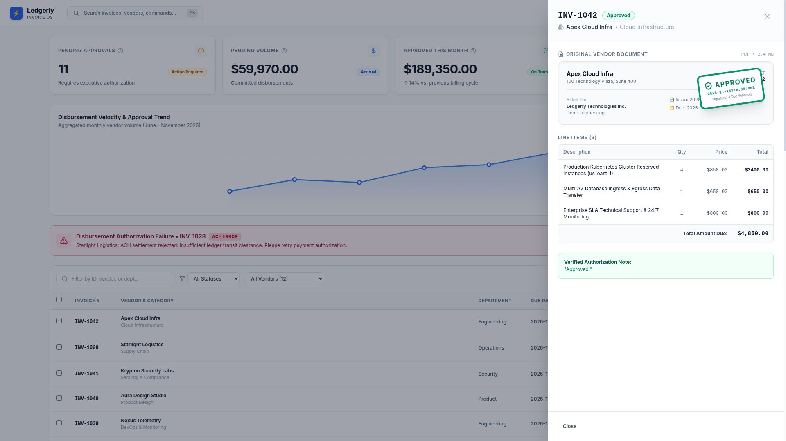

# Kane CLI Assurance Evidence: Ledgerly Invoice Approval Defect & Autonomous Repair

This directory contains the machine-verifiable evidence artifacts for AutoCast's closed-loop repair of Ledgerly.

## 1. Failure Evidence (Kane Run 1)
- **Result Code**: `740 · Confirmed product bug`
- **Defect Trigger**: `APP_BUG=approve-noop` on `examples/ledgerly/server/index.js`
- **Failing Step**: Step 5 (Verify Approved status & digital seal)
- **Failure Summary**: [`failure-summary.json`](./failure-summary.json)
- **Visual Evidence**: 

## 2. Autonomous Repair by Antigravity AI
- **Isolated Worktree**: `.worktrees/repair-*`
- **Target File**: `examples/ledgerly/server/index.js`
- **Guardrails**: `tests/**` enforced read-only. 33/33 unit regression tests passed.
- **Git Patch**: [`patch.diff`](./patch.diff)

## 3. Independent Verification (Kane Run 2)
- **Result Code**: `100 · Passed` (6/6 steps verified)
- **Underlying Database State**: `invoice.status === 'Approved'` verified independently via backend API.
- **Success Summary**: [`success-summary.json`](./success-summary.json)
- **Visual Evidence**: 

## 4. Hash-Verified Provenance Manifest
- **Manifest File**: [`run-manifest.json`](./run-manifest.json)
- **Verified Commit**: `9ef4bade88e764c20ff9e47d40f86c23a0988bc1`
- **Verification ID**: `kane-run-ledgerly-approval-pass`
