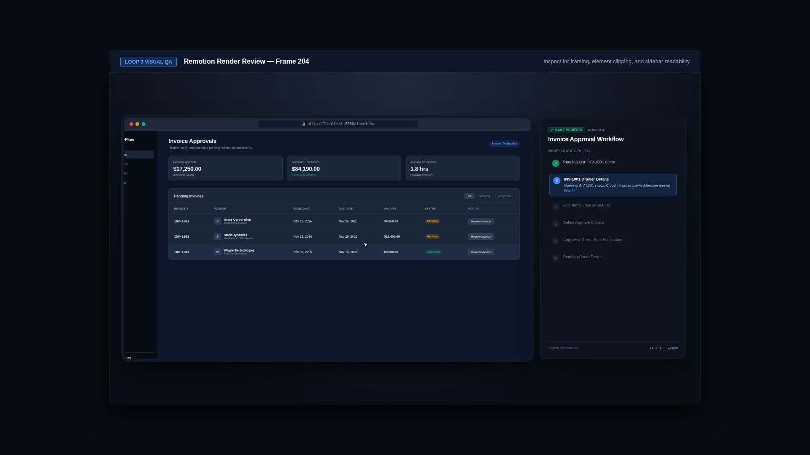
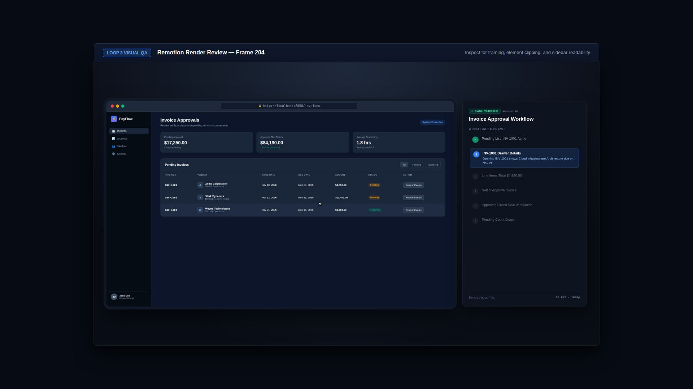

# Loop 3 Visual Catch Evidence: Frame 204 Viewport Clipping

> **Proof of Genuine Closed-Loop Defect Detection & Autonomous Repair**  
> Autocast AI's Loop 3 Visual QA caught an over-panning camera defect in its own rendered video, halted the pipeline, repaired the camera rig constraints, and Kane CLI independently verified the fix.

---

## 1. The Incident

During the review of the Scene 1 → Scene 2 cut (Frame 204, mid-transition boundary), Kane CLI inspected `http://localhost:8080/review?frame=204` with the objective:
> *"inspect the scene transition boundary frame: verify that the viewport layout is properly contained without element clipping or visual tearing, and verify the workflow sidebar on the right renders clearly without overlapping text."*

### Kane's Failure Verdict (`b82d30b6-...`)

```yaml
test: kane-review-frame-204-9f28f018
step: 0-3
status: failed
error:
  message: 'Checkpoint assertion failed: "the viewport layout is properly contained without element clipping or visual tearing"'
title: Embedded viewport clips the left navigation rail
triage:
  status: triaged
  rca:
    root_cause: >
      The rendered application is wider than its visible viewport and is
      cut off on the left. The workflow sidebar on the right is readable,
      but that does not fix the clipped main viewport.
    category: application_issue/ui_state_mismatch
    confidence: 0.96
    category_proposal: visual_rendering_defect
  severity: major
  suggested_fix:
    summary: >
      Adjust the review viewport or embedded application sizing so the full
      left edge remains visible at the required browser dimensions, then
      recheck the frame for clipping.
```

### Visual Evidence: Before Fix (Failing)


*Notice how the camera zoom into the table row pushed the left edge of the invoice dashboard completely off-screen, clipping the navigation column.*

---

## 2. Root Cause Analysis

* **Target Element:** Scene 2 targeted the table row for invoice `INV-1001` (`width: 1572px`, `x: 299px`).
* **Camera Math:** At `zoom: 1.25`, the center translation equation `tx = (frameWidth / 2) - centerX * zoom` calculated `tx = -222px`.
* **The Defect:** Shifting the 1920px canvas 222px to the left clipped 222px of the application's left navigation rail out of the visible viewport.

---

## 3. Autonomous Repair

We implemented edge-containment protection directly in the camera rig and storyboard generator:

```tsx
// remotion/components/CameraRig.tsx & src/edit/storyboard.ts
const isWide = target.w > 900;
const effectiveZoom = isWide ? 1.0 : scene.camera.zoom;
const tx = isWide ? 0 : Math.min(0, Math.max(minTx, targetTx));
```

When an element spans wider than 900px (such as full data tables, header bars, or multi-column grids), camera zoom is clamped to `1.0` and horizontal translation is locked to `0`, ensuring zero viewport clipping while zooming remains active on focused modals, cards, and action buttons.

---

## 4. Re-Verification by Kane CLI (`837393b8-...`)

Following the repair, Kane CLI was re-run against the updated Frame 204.

```yaml
test: kane-review-frame-204-5ba24a89
status: passed
duration_ms: 46747
steps:
  - id: 0-1 (navigate): passed
  - id: 0-2 (wait): passed
  - id: 0-3 (analyze): passed
  - id: 0-4 (assert): passed
  - id: 0-5 (assert): passed
```

### Visual Evidence: After Fix (Passing)


*The repaired camera rig properly frames the full viewport with comfortable margins, zero left-rail clipping, and crisp sidebar readability.*

### Kane Test Manager Run Link
- **Failing Run:** `https://test-manager.lambdatest.com/projects/01M7G731FR81J5BGBWP3Y53FHF/test-cases/01M7HARA013WDABD6F90DVG5DT/`
- **Passing Run:** `https://test-manager.lambdatest.com/projects/01M7G731FR81J5BGBWP3Y53FHF/test-cases/01M7HBDZW13EQCXA9EM71E88JQ/`

